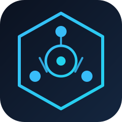

<p align="center">
  
</p>

<h1 align="center">Behavior-OS v2.2</h1>

<p align="center">
  <strong>The Operating System for Autonomous AI Agent Teams</strong>
</p>

<p align="center">
  <a href="#"></a>
  <a href="#"></a>
  <a href="#"></a>
  <a href="#"></a>
  <a href="#"></a>
  <a href="#"></a>
  <a href="https://www.npmjs.com/package/@behavior-os/core"></a>
</p>

---

Behavior-OS is a **behavioral governance framework** that gives AI agent teams DNA-driven rules, deterministic pipelines, and autonomous orchestration. Think of it as an operating system for AI agents — it defines _how_ agents think, decide, collaborate, and learn.

## Quick Demo

```bash
# Install dependencies
pnpm install

# Build all packages
pnpm build

# Initialize a new project scaffold
pnpm exec behavioros init --dna surgical-team

# Run the full test suite (1201 cases, 110 files)
pnpm test

# Type-check (11 packages)
pnpm typecheck

# Run the governance conformance check (24/24 claims)
pnpm verify:governance

# Install the published packages from npm
npm install @behavior-os/sdk @behavior-os/cli @behavior-os/mcp-server

# Scaffold a governed project with the CLI
npx @behavior-os/cli init --dna surgical-team
```

## Why Behavior-OS?

| Without Behavior-OS                      | With Behavior-OS                                                           |
| ---------------------------------------- | -------------------------------------------------------------------------- |
| Agents act unpredictably                 | DNA patterns enforce deterministic behavior                                |
| No audit trail                           | Every action logged & auditable                                            |
| Manual governance review                 | Automated rule evaluation (block/escalate/warn)                            |
| Agents don't learn from mistakes         | Learning engine records events & detects recurring patterns                |
| Hard to coordinate multiple agents       | 7-step protocol + auto-derived missions for traceable work                 |
| No quality gates                         | Quality gates + audit stages (lint → typecheck → security → coverage)      |
| Reinventing infrastructure every project | 48 engine files, 98 MCP tools + 2 resources, CLI, SDK — batteries included |

## Architecture

```
┌──────────────────────────────────────────────────────┐
│                      MISSION LAYER                    │
│   Lifecycle: create → start → execute → complete/fail │
├──────────────────────────────────────────────────────┤
│                     DECISION LAYER                    │
│   Weighted votes → majority / supermajority / quorum  │
├──────────────────────────────────────────────────────┤
│                      LEARNING LAYER                   │
│   Record events → detect recurring patterns           │
├──────────────────────────────────────────────────────┤
│                      QUALITY LAYER                    │
│   Gates: test_coverage / lint / typecheck / security  │
├──────────────────────────────────────────────────────┤
│                      AUDIT LAYER                      │
│   Stages: lint → typecheck → security → coverage      │
│   (simulated by default; real checks opt-in)          │
├──────────────────────────────────────────────────────┤
│                   GATE PIPELINE                       │
│   preflight: governance gate (blocking) → quality     │
├──────────────────────────────────────────────────────┤
│                   GOVERNANCE LAYER                    │
│   Rules: block | escalate | warn | log | transform    │
├──────────────────────────────────────────────────────┤
│                  BEHAVIORAL LAYER                     │
│   Load DNA (YAML) + validate against Zod schemas      │
├──────────────────────────────────────────────────────┤
│                    SCHEMA LAYER                       │
│   Zod v4 schemas for every domain type                │
├──────────────────────────────────────────────────────┤
│                   DNA LAYER (YAML)                    │
│   Personas | governance rules | quality gates         │
└──────────────────────────────────────────────────────┘

> The 9-layer diagram above is documentation of the conceptual stack. The
> **48 engines** listed below are implemented in code; there is no separate
> "Behavioral" or "Compiler" engine.
```

### 48 Core Engines Powering the Stack

| Engine                   | Purpose                                                        |
| ------------------------ | -------------------------------------------------------------- |
| GovernanceEngine         | Rule-based governance evaluation with caching                  |
| QualityEngine            | Quality gate enforcement (gte/lte/eq/neq)                      |
| AuditEngine              | Multi-stage audit pipeline (real or simulated)                 |
| LearningEngine           | Pattern detection + confidence-scored DNA evolution proposals  |
| MissionEngine            | In-memory mission lifecycle management                         |
| PipelineEngine           | Ordered gates with synchronous pre-execution blocking          |
| DecisionEngine           | Weighted voting/quorum (majority/supermajority/unanimous)      |
| RecommendationEngine     | Scored recommendations from learning events                    |
| DriftEngine              | Behavioral drift between DNA snapshots                         |
| CodeEditEngine           | Guarded dry-run-by-default file edits with before/after hashes |
| DNALoader                | YAML pattern loading with Zod validation                       |
| CrossDnaLearningEngine   | Cross-DNA pattern transfer between patterns                    |
| PipelineRecoveryEngine   | Retry/circuit-breaker with plan persistence                    |
| ConsensusEngine          | Multi-agent consensus voting                                   |
| PredictionEngine         | Governance outcome prediction from historical data             |
| TemporalGovernanceEngine | Time-conditional governance rules                              |
| BrainstormEngine         | Multi-agent brainstorm sessions                                |
| AntipatternEngine        | Detect anti-patterns in agent behavior                         |
| MetacognitionEngine      | Agent self-reflection and metacognitive tracking               |
| KnowledgeGraphEngine     | Knowledge graph construction and querying                      |
| (…and 27 more)           | Full list in `packages/core/src/engine/` (48 total)            |

## Features Deep Dive

### DNA Pattern System

Behavioral blueprints in YAML that define agent roles, governance rules, quality gates, and workflows.

```yaml
# dnas/surgical-team.yaml
personas:
  - role: architect
    name: Lead Surgeon
    authority: architect
    boundaries:
      - id: max-procedures
        type: max_modules
        value: 1
    skills: [surgical-procedure, team-leadership, clinical-decision]

governance:
  - id: sterile-field
    level: critical
    action: block
    conditions: [type:sterile-procedure, type:instrument-handling]

quality:
  - id: zero-defect
    type: test_coverage
    threshold: 100
```

### 21 DNA Patterns

These are the 21 patterns actually shipped in `dnas/*.yaml`:

| Pattern (file)            | Domain                                         |
| ------------------------- | ---------------------------------------------- |
| **ai-ml-pipeline**        | ML training, datasets, drift, inference        |
| **blockchain-web3**       | Smart contracts, on-chain, wallets             |
| **cloud-native**          | Kubernetes, containers, IaC                    |
| **data-engineering**      | ETL, warehouses, data quality, lineage         |
| **devops-pipeline**       | CI/CD, releases, rollbacks                     |
| **enterprise-governance** | Compliance, change control, audit              |
| **enterprise-sox**        | SOX, segregation of duties, internal controls  |
| **financial-compliance**  | KYC/AML, transaction monitoring                |
| **fintech-trading**       | Order books, latency, risk limits              |
| **gaming-studio**         | Game pipelines, shaders, anti-cheat            |
| **healthcare-hipaa**      | HIPAA, PHI, patient records                    |
| **iot-embedded**          | Firmware, sensors, RTOS                        |
| **lean-factory**          | Kaizen, waste reduction, value stream          |
| **legacy-modernization**  | Strangler patterns, COBOL migration            |
| **military-operations**   | Chain of command, OPSEC, mission focus         |
| **mobile-app**            | iOS/Android, app stores                        |
| **open-source**           | PRs, licensing, changelog/DCO                  |
| **quantum-computing**     | Qubits, circuits, Qiskit                       |
| **research-lab**          | Experiments, reproducibility                   |
| **startup-agile**         | Sprints, MVPs, backlogs                        |
| **surgical-team**         | Zero-defect, sterile-field, production changes |

> There is **no** `eaarg`, `e-commerce`, `gaming-platform`, `nextjs-nestjs`,
> `python-go-microservices`, or `complex-monorepo` DNA file in this repository.
> Patterns are plain YAML validated by Zod — there is no separate "SkillEngine".

### MCP Server — 86 Tools + 2 Resources

Connect Behavior-OS to any MCP-capable client (Claude Code, Cursor, VS Code, Windsurf):

| Category             | Tools                                                                                                                                     |
| -------------------- | ----------------------------------------------------------------------------------------------------------------------------------------- |
| **Governance**       | `bos_select_dna`, `bos_list_dna`, `bos_evaluate_governance`, `bos_preflight`, `bos_predict_governance`, `bos_resolve_consensus`           |
| **Mission**          | `bos_create_mission`, `bos_start_mission`, `bos_list_missions`, `bos_complete_mission`, `bos_fail_mission`, `bos_cancel_mission`          |
| **Quality**          | `bos_check_quality`, `bos_evaluate_fairness`, `bos_run_audit`                                                                             |
| **Decision**         | `bos_decide`, `bos_create_meta_decision`, `bos_get_meta_cognition_stats`                                                                  |
| **Evolution**        | `bos_evolution`, `bos_code_fixes`, `bos_apply_code_fixes`, `bos_list_code_fixes`                                                          |
| **Code editing**     | `bos_code_edit` (dry-run by default), `bos_list_code_edits`                                                                               |
| **Learning**         | `bos_record_learning`, `bos_get_insights`, `bos_suggest_cross_dna_transfer`                                                               |
| **Status**           | `bos_get_status`, `bos_get_state`, `bos_set_agent`, `bos_whoami`                                                                          |
| **Listing**          | `bos_list_decisions`, `bos_list_pipeline_runs`, `bos_list_audit_reports`                                                                  |
| **Analytics**        | `bos_recommendations`, `bos_get_metrics`, `bos_reset_metrics`                                                                             |
| **Drift**            | `bos_drift`                                                                                                                               |
| **Governance Log**   | `bos_get_log`, `bos_verify_audit_trail`                                                                                                   |
| **Collaboration**    | `bos_create_brainstorm`, `bos_list_brainstorms`, `bos_propose_idea`, `bos_vote_idea`                                                      |
| **Dynamic DNA**      | `bos_create_dynamic_dna`, `bos_override_rule`                                                                                             |
| **Behavioral UX**    | `bos_behavior_profile`, `bos_behavior_diff`, `bos_teach_behavior`, `bos_behavior_timeline`, `bos_behavior_summary`, `bos_behavior_report` |
| **Antipatterns**     | `bos_scan_antipatterns`, `bos_fix_antipatterns`, `bos_antipattern_report`                                                                 |
| **Conversations**    | `bos_start_conversation`, `bos_add_conversation_turn`, `bos_resolve_conversation`, `bos_conversation_report`, `bos_list_conversations`    |
| **Roles**            | `bos_register_role`, `bos_define_policy`, `bos_evaluate_role_action`, `bos_role_policy_report`, `bos_list_roles`                          |
| **Policy lifecycle** | `bos_policy` (list, status, events, create, validate, approve, activate, deactivate, rollback, monitor)                                   |
| **Agent Capacity**   | `bos_register_agent_capacity`, `bos_assign_task`, `bos_complete_task`, `bos_analyze_workload`, `bos_recommend_assignment`                 |
| **Natural Language** | `bos_parse_rule`, `bos_parse_rules_batch`, `bos_apply_natural_language_rules`                                                             |
| **Temporal**         | `bos_add_temporal_rule`, `bos_check_temporal`, `bos_evaluate_dna_temporal`                                                                |
| **Knowledge Graph**  | `bos_add_knowledge_node`, `bos_add_knowledge_edge`, `bos_query_knowledge_graph`, `bos_get_knowledge_graph_stats`                          |
| **Memory**           | `bos_save_memory`, `bos_recall_memory`, `bos_recall_relevant`, `bos_reconstruct_context`, `bos_consolidate_memory`                        |

Resources: `behavioros://protocol/steps`, `behavioros://dna/catalog`

**Responsible AI:** `bos_evaluate_fairness` computes demographic parity, disparate
impact and equal opportunity from per-group counts, checks data provenance (distinct
from evidence provenance) and enforces human oversight before a high-impact decision
proceeds. Fairness, provenance and oversight are reported separately — a fair outcome
does not excuse missing provenance or a missing reviewer.

The OpenCode v2 plugin additionally exposes `bos_get_log` and
`bos_verify_audit_trail` (91 tools in total).

**Governed policy lifecycle:** `bos_policy` records immutable versions
(`policyId@N`) of a policy statement, validates a version, requires a human
actor (and, when `BEHAVIOR_OS_APPROVAL_KEY` is set, a signed approval token) to
approve and activate it, and supports deactivation and rollback. An active
version may carry a machine-readable enforcement block (`block`, `escalate`,
`require` or `warn`); `bos_evaluate_governance` then applies it to every
matching action, with `deny` never softened by lenient mode. The whole
lifecycle is appended to the hash-chained governance log.

### Persistence (opt-in)

State survives restarts. The default store uses the built-in `node:sqlite` module
(Node ≥ 22.5, **no external dependency**): `missions`, `learnings`, `agents`,
`audit_log`, `pipeline_runs`, `decisions`, `code_fix_results`, `code_edits` and a
key/value `meta` table (9 tables total).

```ts
const bos = new BehaviorOS({ persistence: { path: './behavioros.db' } });
```

For the MCP server, set `BEHAVIOROS_DB_PATH` instead. Without a path the engine
runs fully in memory; an unusable path degrades to memory rather than throwing.

Any store implementing the `Store` interface can be injected — for example
`PostgresStore` (which resolves the optional `pg` driver lazily and keeps an
in-memory mirror with async write-through):

```ts
const store = new PostgresStore({ connectionString: process.env.DATABASE_URL });
await store.connect();
const bos = new BehaviorOS({ persistence: { store } });
```

### MCP tool rate limiting

Every MCP tool is throttled in-process with a per-tool token bucket. The default
is **300 calls per tool per 60 s** (5/s average), which stops a looping agent
without starving unrelated tools:

| Variable                              | Default | Meaning                                                     |
| ------------------------------------- | ------- | ----------------------------------------------------------- |
| `BEHAVIOROS_MCP_RATE_LIMIT_MAX`       | `300`   | Bucket capacity / calls per window                          |
| `BEHAVIOROS_MCP_RATE_LIMIT_WINDOW_MS` | `60000` | Refill window in milliseconds                               |
| `BEHAVIOROS_MCP_RATE_LIMIT_DISABLED`  | unset   | `true` disables the limiter (trusted local automation only) |

A throttled call does no engine work and returns a normal tool error
(`isError: true`) with the retry delay. The limiter is per process and per tool;
it is a runaway-agent guard, not a distributed quota or an authorization layer.

### Governed Code Editing (opt-in)

Behavior-OS can apply a code change, but never by surprise:

```ts
// Dry run: computes hashes + a unified diff, writes nothing.
const preview = bos.applyCodeEdit({
  file: 'src/app.ts',
  find: 'const t = 1;',
  replace: 'const t = 2;',
});
// { applied: false, reason: 'dry-run', preview: { beforeHash, afterHash, diff, … } }

// A write needs the opt-in *and* an explicit apply.
const bos2 = new BehaviorOS({ codeEdit: { enabled: true, root: process.cwd() } });
bos.applyCodeEdit({
  file: 'src/app.ts',
  find: 'const x = 1;',
  replace: 'const x = 2;',
  apply: true,
});
```

Guard rails: the file must resolve (realpath) **inside** the workspace root, the
extension must be on the allowlist, the `find` text must occur **exactly once**,
the file must stay under 1 MiB, and a stale `expectedBeforeHash` is refused
instead of overwritten. The write itself is atomic (temp file + rename). Every
evaluation — dry-runs and refusals included — is persisted with both hashes, so
the history of refusals is auditable:

```ts
bos.listCodeEdits(); // CodeEditRecord[] with beforeHash / afterHash / reason
```

Enable it with env vars: `BEHAVIOR_OS_CODE_EDIT=true` (plugin) or
`BEHAVIOROS_CODE_EDIT=true` (MCP), plus `*_CODE_EDIT_ROOT` to bound the tree.

### CLI Reference

Run `behavioros <command> --help` for the exact flags. Every command uses exit
code `0` (success) or `1` (missing `dnas/`, invalid DNA, failed validation,
blocked `deploy` pre-flight, `autonomous` without `--task`).

| Command                            | What it actually does                                                                                     |
| ---------------------------------- | --------------------------------------------------------------------------------------------------------- |
| `npx @behavior-os/cli init`        | Scaffold a project (`.behavioros/state.json`, `.mcp.json`, sample DNA)                                    |
| `npx @behavior-os/cli compile`     | Parse and validate **every** `dnas/*.yaml` against the DNA schema                                         |
| `npx @behavior-os/cli validate`    | Validate the project layout plus every DNA pattern                                                        |
| `npx @behavior-os/cli status`      | Engine status (DNA, missions, agents) + `.behavioros/state.json`                                          |
| `npx @behavior-os/cli diff`        | Compare `dnas/*.yaml` against `.behavioros/baseline.json`                                                 |
| `npx @behavior-os/cli simulate`    | Evaluate one action against the loaded DNA rules                                                          |
| `npx @behavior-os/cli deploy`      | Print the deployment gate plan + a real pre-flight (**does not deploy**)                                  |
| `npx @behavior-os/cli ecosystem`   | Report what can be read from disk (DNA patterns, verdicts)                                                |
| `npx @behavior-os/cli agent`       | Show the local state summary and registered agents from the SQLite registry                               |
| `npx @behavior-os/cli autonomous`  | Dry-run the 7-step protocol on `--task` (audit simulated, no work executed)                               |
| `npx @behavior-os/cli protocol`    | Check the 7 steps against the local state file                                                            |
| `npx @behavior-os/cli drift-check` | Compare every DNA rule/gate with the baseline (`DriftEngine`; exits 1 on drift)                           |
| `npx @behavior-os/cli metrics`     | Display governance metrics (governance events, latency, deny/allow rates) with `--json` / `--reset` flags |

## Test Status

Counted from the repository (not aspirational). Run `pnpm test` for the live result.

| Metric                               | Value                                                      |
| ------------------------------------ | ---------------------------------------------------------- |
| Test files (`*.test.ts`)             | 110                                                        |
| Test cases (executed by `pnpm test`) | 1201                                                       |
| Typecheck                            | `pnpm typecheck` (11/11 tasks, 0 errors)                   |
| Build                                | `pnpm build` (ESM + DTS)                                   |
| Coverage                             | `pnpm test:coverage` (same 110 files / 1201 cases, exit 0) |
| Publishability                       | `pnpm verify:publish` (packed manifests, exit 0)           |
| Lint                                 | `pnpm lint:check` (Biome, clean)                           |
| Clean                                | `pnpm clean` (8/8 tasks, removes `dist/`)                  |

## Quick Start

```bash
# Option A — install the published packages
npm install @behavior-os/sdk @behavior-os/cli @behavior-os/mcp-server

# Option B — work on the framework itself
pnpm install
pnpm build
pnpm test
pnpm typecheck
```

```typescript
import { BehaviorOS } from '@behavior-os/sdk';

const bos = new BehaviorOS({
  dnaPath: './dnas/enterprise-governance.yaml',
  quality: { enabled: true, minCoverage: 80 },
  audit: { enabled: true },
  learning: { enabled: true },
});

const mission = bos.createMission({
  title: 'Implement payment module',
  type: 'feature',
  priority: 'high',
});

const status = bos.getStatus();
// → { engine: true, dna: 'Enterprise Governance', missions: 1, agents: 5, ... }
```

## MCP Setup

After `npm install @behavior-os/mcp-server` the `behavioros-mcp` binary is
available (`npx behavioros-mcp` runs it without a global install).

### Claude Code

Create `.mcp.json`:
```json
{
  "mcpServers": {
    "behavioros": {
      "command": "node",
      "args": ["packages/mcp-server/dist/server.js"],
      "env": {
        "BEHAVIOROS_DNA_PATH": "./dnas/enterprise-governance.yaml"
      }
    }
  }
}
```

### Cursor

Create `.cursor/mcp.json` with the same config as Claude Code.

### VS Code + GitHub Copilot

Create `.vscode/mcp.json` with the same config as Cursor.

### OpenCode v2 (recommended — native plugin)

The `@behavior-os/opencode-plugin` is the native OpenCode v2 integration. It
ships in this repository and is **not** published to npm: it is auto-loaded from
`.opencode/plugins/behavioros.ts`, a thin loader that re-exports the built
package; it exposes the full 91 `bos_*` tool surface plus governance hooks
(`tool:execute.before`, `tool:execute.after`) and session context — no MCP server
registration required.

The MCP server is intentionally **not** registered inside OpenCode so sessions
see a single, non-duplicated tool catalog. For other MCP-capable hosts use the
sections above.

### Windsurf

Add to `.windsurfrules`:
```yaml
mcpServers:
  behavioros:
    command: node
    args: [packages/mcp-server/dist/server.js]
    env:
      BEHAVIOROS_DNA_PATH: "./dnas/enterprise-governance.yaml"
```

## Packages

| Package                        | Description                                                                                                                              | Version |
| ------------------------------ | ---------------------------------------------------------------------------------------------------------------------------------------- | ------- |
| `@behavior-os/schemas`         | Zod v4.4.3 schemas for all types                                                                                                         | 2.2.2   |
| `@behavior-os/core`            | 48 engines + BehaviorOS facade + persistence (SQLite/Postgres)                                                                           | 2.2.2   |
| `@behavior-os/sdk`             | High-level TypeScript SDK (mission lifecycle, governance, learning)                                                                      | 2.2.2   |
| `@behavior-os/cli`             | CLI (13 commands: init, compile, validate, status, diff, simulate, deploy, ecosystem, agent, autonomous, protocol, drift-check, metrics) | 2.2.2   |
| `@behavior-os/mcp-server`      | MCP server with 98 tools + 2 resources                                                                                                   | 2.2.2   |
| `@behavior-os/opencode-plugin` | OpenCode v2 plugin with 91 tools + hooks - loaded from this workspace, not published to npm                                              | 2.1.0   |
| `behavioros-orchestrator`      | Real task orchestration (shell adapter, retries, circuit breaker, persistent control loop)                                               | 1.0.1   |

## License

MIT License — see [LICENSE](LICENSE) for details.

---

<p align="center">
  Created by <strong>Ilvan Joaquim</strong> from Angola 🇦🇴<br>
  <a href="https://github.com/ilvan-develop/behavior-os-governance">GitHub</a> ·
  <a href="./docs/PROTOCOL.md">Protocol</a> ·
  <a href="./docs/ARCHITECTURE.md">Architecture</a>
</p>
