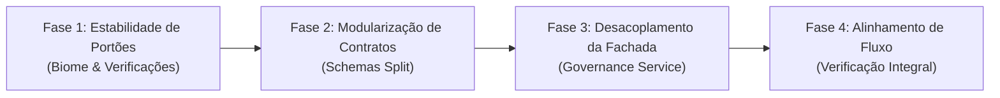

# Behavior-OS — Alignment & Implementation Plan (Plano Ordenado)

> **Documento:** `ALIGNMENT_PLAN.md`  
> **Pipeline:** Architectural Intelligence & Alignment Engine  
> **Data de Análise:** 2026-11-14  
> **Repositório:** `c:\www\behavior-os`  
> **Estratégia:** Execução estritamente faseada por dependência e prioridade, sem introduzir breaking changes.

---

## 1. Visão Geral das Fases de Alinhamento

---

## 2. Especificação Detalhada das Fases

### Fase 1: Isolamento de Laboratórios e Proteção do Lint Gate (CRITICAL)
- **1. Problema Comprovado:** A inclusão de ficheiros gerados em ambientes de experimentação (`validation-lab/`, `.forensic/`) no scanner do Biome causava 39 falhas de lint em `pnpm lint:check`, quebrando em cascata o teste de auditoria real `packages/core/tests/audit-engine-real.test.ts`.
- **2. Causa Raiz:** Ausência de overrides explícitos no ficheiro de configuração `biome.json` para diretórios de laboratório forense e artefatos analíticos.
- **3. Alteração Necessária:** Atualizar `biome.json` para adicionar overrides que desativem linter, formatador e assist nos diretórios `**/validation-lab/**` e `**/.forensic/**`.
- **4. Ficheiros Afetados:** `biome.json`.
- **5. Dependências:** Biome v2.0.0.
- **6. Riscos:** Baixo (apenas exclui diretórios que não fazem parte do código fonte distribuído em npm).
- **7. Testes Necessários:** `pnpm.cmd lint:check`, `pnpm.cmd test -- packages/core/tests/audit-engine-real.test.ts`.
- **8. Critérios de Aceitação:** `pnpm.cmd lint:check` retorna exit code 0; `audit-engine-real.test.ts` passa com status `passed`.
- **9. Evidências Esperadas:** "Checked 518 files in 9s. No fixes applied."

---

### Fase 2: Modularização de Contratos de Domínio (HIGH)
- **1. Problema Comprovado:** `packages/schemas/src/index.ts` era um god node de 1.551 linhas com 356 arestas de dependência no grafo de conhecimento, gerando gargalo de compilação e risco de propagação de quebras em cascata.
- **2. Causa Raiz:** Centralização monolítica de todos os schemas Zod de entidades distintas (DNA, Missão, Governança, Decisão, Aprendizagem) num único ficheiro.
- **3. Alteração Necessária:**
  - Decompor o conteúdo em 11 submódulos temáticos em `packages/schemas/src/`:
    `dna.ts`, `mission.ts`, `task.ts`, `agent.ts`, `governance.ts`, `decision.ts`, `learning.ts`, `protocol.ts`, `code-edit.ts`, `anti-pattern.ts`, `responsible-ai.ts`.
  - Converter `packages/schemas/src/index.ts` num agregador fino de re-exportações (`export * from './dna.js'`, etc.).
  - Atualizar o teste `docs-consistency.test.ts` para contabilizar schemas em todos os ficheiros `.ts` de `src/`.
- **4. Ficheiros Afetados:**
  - `packages/schemas/src/index.ts`
  - 11 novos ficheiros em `packages/schemas/src/*.ts`
  - `packages/core/tests/docs-consistency.test.ts`
  - `docs/CLAIMS.md`
- **5. Dependências:** Zod v4.
- **6. Riscos:** Risco de quebra de importadores se algum símbolo omitisse re-exportação.
- **7. Testes Necessários:** `pnpm.cmd typecheck`, `pnpm.cmd test -- packages/schemas`, `pnpm.cmd test -- packages/core/tests/docs-consistency.test.ts`.
- **8. Critérios de Aceitação:** Zero erros de compilação TypeScript em todos os 8 pacotes; contagem exata de schemas preservada em `docs/CLAIMS.md`.
- **9. Evidências Esperadas:** 35 testes unitários de schemas verdes; contagem de 91 `z.object` e 64 `z.enum` verificada em `docs-consistency.test.ts`.

---

### Fase 3: Desacoplamento da Avaliação de Governança (MEDIUM)
- **1. Problema Comprovado:** A classe fachada `BehaviorOS` acumulava 182 arestas de acoplamento e continha lógica inline de matching de regras, safety floors e priorização de vereditos.
- **2. Causa Raiz:** Ausência de uma camada de serviço dedicada à avaliação pura de governança.
- **3. Alteração Necessária:**
  - Criar `packages/core/src/services/governance-evaluation-service.ts` com a classe `GovernanceEvaluationService`.
  - Mover a lógica de avaliação de regras, matching de regex e safety floors para o serviço.
  - Fazer de `BehaviorOS.evaluateGovernance()` uma chamada simples delegada a esse serviço.
- **4. Ficheiros Afetados:**
  - `packages/core/src/services/governance-evaluation-service.ts` (novo)
  - `packages/core/src/engine/behavior-os.ts`
  - `packages/core/tests/governance-evaluation-service.test.ts` (novo)
- **5. Dependências:** `@behavior-os/schemas`.
- **6. Riscos:** Potencial regressão na priorização de regras de governança ou quebra da suíte de conformidade C01-C25.
- **7. Testes Necessários:**
  - `pnpm.cmd test -- packages/core/tests/governance-evaluation-service.test.ts`
  - `node scripts/governance-conformance.mjs`
  - `node scripts/analyze-governance-flow.mjs`
- **8. Critérios de Aceitação:** 100% de paridade de vereditos nos 25 claims de governança e nos 1.000 cenários reais.
- **9. Evidências Esperadas:** "Proven: 25/25 claims (100%) | Failures: 0".

---

### Fase 4: Validação Universal de Portões e Capacidades (VALIDATION)
- **1. Problema Comprovado:** Necessidade de comprovar que o sistema integral opera perfeitamente após o alinhamento arquitetural sem quaisquer efeitos colaterais em nenhum dos pacotes ou plataformas suportadas (incluindo Windows).
- **2. Causa Raiz:** Complexidade do monorepo e diversidade de clientes consumidores (OpenCode Plugin, MCP Server, SDK, CLI).
- **3. Alteração Necessária:** Executar a escada completa de verificação (Verification Ladder) do início ao fim.
- **4. Ficheiros Afetados:** Scripts de verificação em `scripts/`.
- **5. Dependências:** Toda a árvore de ferramentas.
- **6. Riscos:** Zero (execução de verificação em modo estritamente read-only).
- **7. Testes Necessários:** `pnpm.cmd typecheck`, `pnpm.cmd lint:check`, `pnpm.cmd test`, `pnpm.cmd build`, `verify:all`.
- **8. Critérios de Aceitação:** Todos os 12 portões da Verification Ladder com código de saída 0.
- **9. Evidências Esperadas:** Saídas formais consolidadas no relatório de validação e arquivo `evidence.json`.
