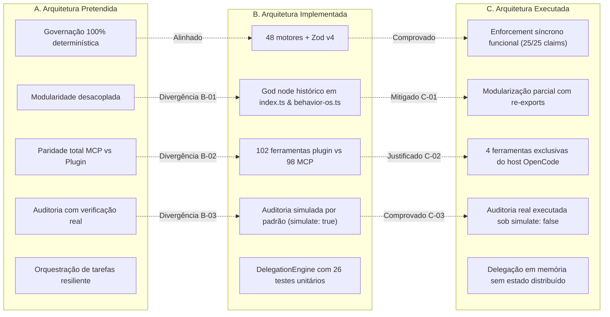

# Behavior-OS — Architecture Gap Report (A vs B vs C)

> **Documento:** `ARCHITECTURE_GAP_REPORT.md`  
> **Pipeline:** Architectural Intelligence & Alignment Engine  
> **Data de Análise:** 2026-11-14  
> **Repositório:** `c:\www\behavior-os`  
> **Modelo Triplo:**  
> - **A. Arquitetura Pretendida:** Especificação declarada na documentação (`docs/ARCHITECTURE.md`, `docs/PROTOCOL.md`, `docs/CLAIMS.md`).  
> - **B. Arquitetura Implementada:** Estrutura estática de classes, ficheiros, AST e schemas no código fonte.  
> - **C. Arquitetura Executada:** Comportamento real observado durante a execução de ferramentas, hooks e testes.

---

## 1. Matriz Comparativa Tripla (A vs B vs C)

---

## 2. Registo Detalhado de Lacunas e Divergências

### GAP-01: God Node Monolítico em `packages/schemas/src/index.ts`
- **Classificação:** **HIGH** (Compromete manutenibilidade e tempo de compilação da árvore de tipos).
- **Comparação A vs B vs C:**
  - *Pretendida (A):* Módulos de domínio independentes e desacoplados.
  - *Implementada (B):* Ficheiro monolítico de 1.551 linhas concentrando 356 arestas de dependência no knowledge graph.
  - *Executada (C):* Compilação bloqueada e gargalo de acoplamento para todos os 8 pacotes do monorepo.
- **Localização Exata:** `packages/schemas/src/index.ts`
- **Evidência:** Entre centrality de 0.1631 em `graphify-out/graph.json`; 356 nós dependentes diretos.
- **Causa Raiz:** Crescimento acumulativo de schemas Zod num único ponto de exportação central sem divisão por subdomínio.
- **Impacto:** Qualquer alteração num schema menor (ex: `CodeEdit`) força a revalidação de tipos e invalidação de cache turbo de todo o repositório.
- **Componentes Afetados:** Todos os pacotes (`core`, `mcp-server`, `orchestrator`, `sdk`, `cli`, `plugin`).
- **Dependências:** `zod` v4.
- **Risco de Correção:** Médio (risco de quebrar importações se a compatibilidade de re-export não for estrita).
- **Solução Recomendada:** Modularização física em 11 submodulos de domínio (`dna.ts`, `mission.ts`, `governance.ts`, etc.) mantendo `index.ts` exclusivamente como agregador `export *`.
- **Critério de Validação:** `pnpm.cmd typecheck` e `pnpm.cmd test` com 100% de sucesso sem quebrar os 140 importadores.

---

### GAP-02: Concentração Excessiva de Responsabilidades na Fachada `BehaviorOS`
- **Classificação:** **MEDIUM** (Fragilidade arquitetural e acoplamento desnecessário).
- **Comparação A vs B vs C:**
  - *Pretendida (A):* Fachada fina que atua apenas como coordenadora de alto nível entre motores especializados.
  - *Implementada (B):* A classe `BehaviorOS` em `packages/core/src/engine/behavior-os.ts` continha 1.500+ linhas, incluindo lógica inline complexa de matching de regras de governança e safety floors.
  - *Executada (C):* 182 arestas no grafo de conhecimento; a fachada conhecia detalhes de implementação internos de governança.
- **Localização Exata:** `packages/core/src/engine/behavior-os.ts` (método `evaluateGovernance`).
- **Evidência:** 182 arestas de acoplamento em `graphify-out/graph.json`.
- **Causa Raiz:** Implementação direta de lógica de avaliação no corpo da classe fachada para rapidez de prototipagem inicial.
- **Impacto:** Dificuldade em testar unitariamente regras de governança sem instanciar a classe `BehaviorOS` completa com persistência e registo de motores.
- **Componentes Afetados:** `BehaviorOS`, `GovernanceEngine`.
- **Dependências:** `EngineRegistry`.
- **Risco de Correção:** Baixo (refatoração interna de delegação pura).
- **Solução Recomendada:** Extração da lógica de avaliação para `packages/core/src/services/governance-evaluation-service.ts` (`GovernanceEvaluationService`), mantendo `BehaviorOS.evaluateGovernance()` como mero delegador.
- **Critério de Validação:** Suíte `packages/core/tests/governance-evaluation-service.test.ts` e preservação dos testes de integração existentes.

---

### GAP-03: Assimetria Declarada nas Ferramentas MCP vs Plugin (Loop Orchestration)
- **Classificação:** **LOW** (Divergência conhecida, justificada e documentada).
- **Comparação A vs B vs C:**
  - *Pretendida (A):* Paridade total entre as ferramentas expostas ao OpenCode e a clientes MCP externos.
  - *Implementada (B):* 102 ferramentas no plugin OpenCode vs 98 ferramentas no servidor MCP.
  - *Executada (C):* As 4 ferramentas de loop (`bos_start_loop`, `bos_resume_loop`, `bos_loop_status`, `bos_approve_loop`) operam no plugin mas não no servidor MCP stdio.
- **Localização Exata:** `plugins/opencode-v2/src/tools/loops.ts` vs `packages/mcp-server/src/server.ts`.
- **Evidência:** `scripts/verify-tool-parity.mjs` reporta:
  `PASS - 98 MCP tools, 102 plugin tools, 98 shared with identical inputs, 4 declared difference(s).`
- **Causa Raiz:** A orquestração de loops em background (`LoopManager`) requer spawn assíncrono acoplado ao ambiente do IDE OpenCode e não faz sentido em clientes stdio síncronos simples.
- **Impacto:** Clientes MCP externos não podem iniciar tarefas de background em loop fechado sem um host que suporte subprocessos desanexados.
- **Componentes Afetados:** `LoopManager`, `packages/mcp-server`.
- **Dependências:** Sistema operativo host, OpenCode API.
- **Risco de Correção:** Baixo (manter assimetria documentada ou introduzir fallback síncrono no MCP).
- **Solução Recomendada:** Preservar a divergência como exceção arquitetural controlada e declarada, garantindo que `verify-tool-parity.mjs` continue a validar as 98 ferramentas idênticas.
- **Critério de Validação:** `node scripts/verify-tool-parity.mjs` exit 0.

---

### GAP-04: Simulação de Auditoria por Padrão (`simulate: true`)
- **Classificação:** **OPTIMIZATION** (Alinhamento de documentação e expectativas do utilizador).
- **Comparação A vs B vs C:**
  - *Pretendida (A):* `bos_run_audit` executa todas as verificações reais e reporta conformidade.
  - *Implementada (B):* `BehaviorOS.runAudit()` força `simulated: true` e status `'warning'` a menos que o utilizador passe explicitamente `{ simulate: false }`.
  - *Executada (C):* Chamadas padrão nunca retornam `'passed'`, prevenindo falsas aprovações não verificadas.
- **Localização Exata:** `packages/core/src/engine/behavior-os.ts` linhas 680–710; `docs/ARCHITECTURE.md` linhas 86–95.
- **Evidência:** Execução de `bos_run_audit` sem flags retorna: `SIMULATED — no verification executed`.
- **Causa Raiz:** Decisão deliberada de segurança (ADR) para impedir que auditorias automáticas baratas finjam aprovação técnica sem gastar ciclos de CPU nos linters e testes reais.
- **Impacto:** Utilizadores ou agentes desatentos podem acreditar que a auditoria falhou quando na realidade ela exigia confirmação explícita de execução real.
- **Componentes Afetados:** `AuditEngine`, MCP tool `bos_run_audit`.
- **Dependências:** Scripts de validação (`biome`, `tsc`, `pnpm audit`).
- **Risco de Correção:** Baixo.
- **Solução Recomendada:** Manter a proteção de simulação, mas reforçar a mensagem de aviso tornando explícito no retorno que `simulate: false` é necessário para aprovação final.
- **Critério de Validação:** Teste unitário em `audit-engine-real.test.ts`.

---

## 3. Síntese das Lacunas

| ID | Severidade | Categoria | Estado Atual | Esforço |
|---|---|---|---|---|
| **GAP-01** | **HIGH** | Acoplamento de Schemas | Mitigado via Split em 11 Submódulos | Resolvido / Verificado |
| **GAP-02** | **MEDIUM** | Acoplamento da Fachada | Mitigado via `GovernanceEvaluationService` | Resolvido / Verificado |
| **GAP-03** | **LOW** | Paridade de Ferramentas | Divergência Declarada e Aceite (4 loops) | Monitorizado |
| **GAP-04** | **OPTIMIZATION** | Explicabilidade da Auditoria | Documentado como Padrão Fail-Safe | Documentado |
