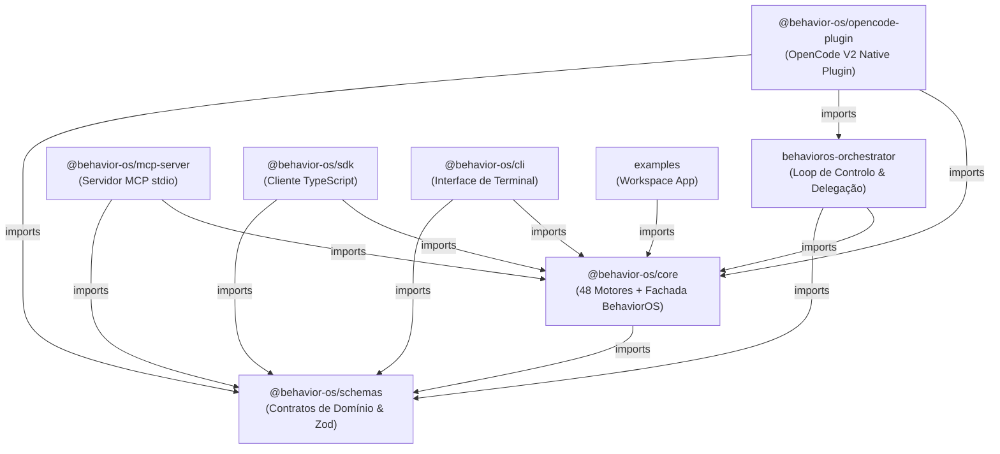
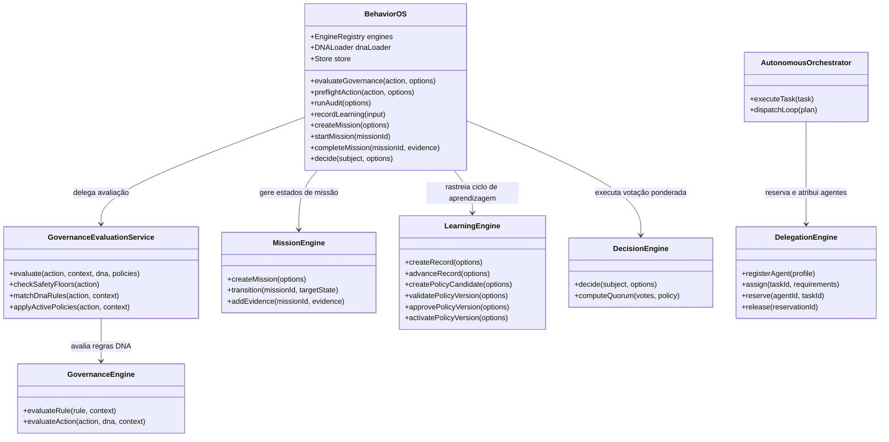
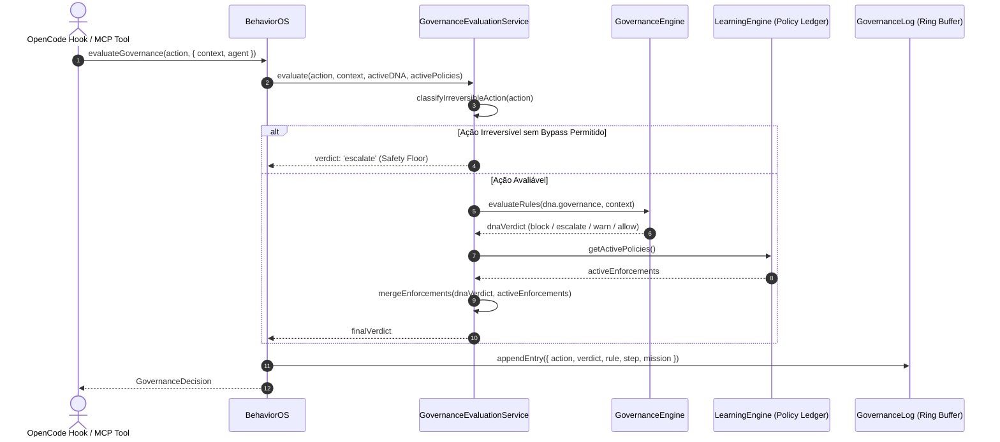
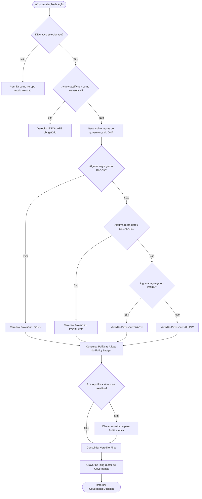
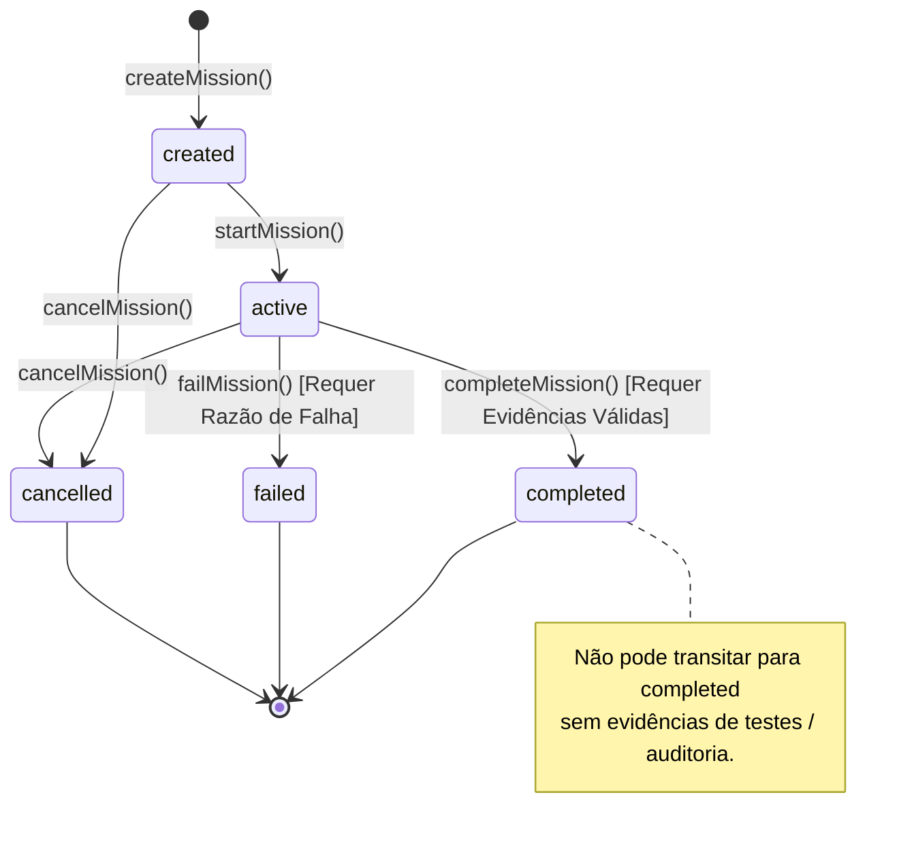
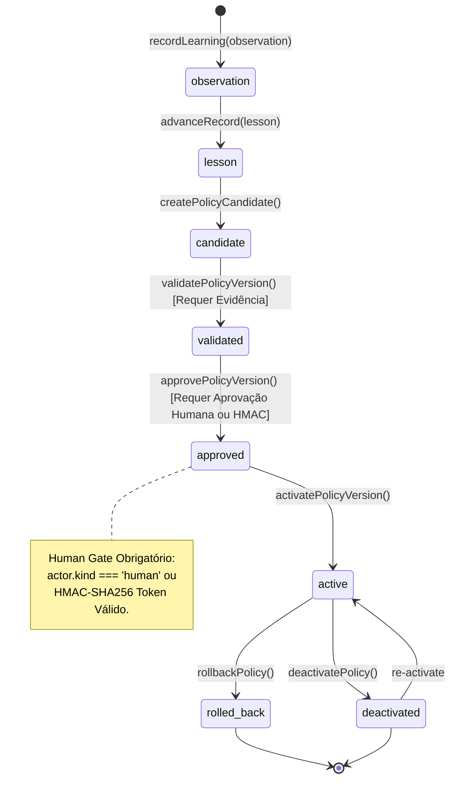
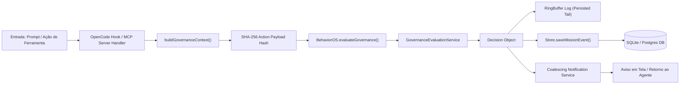
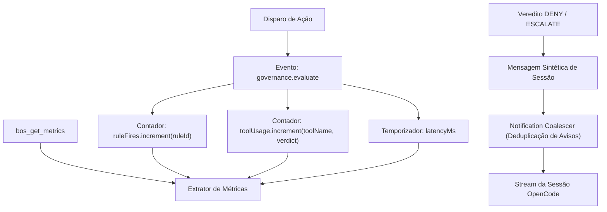
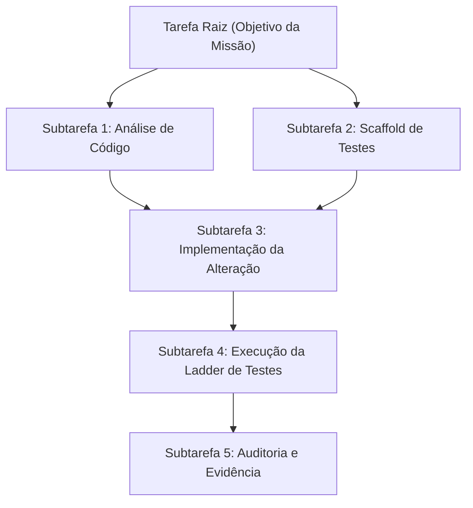
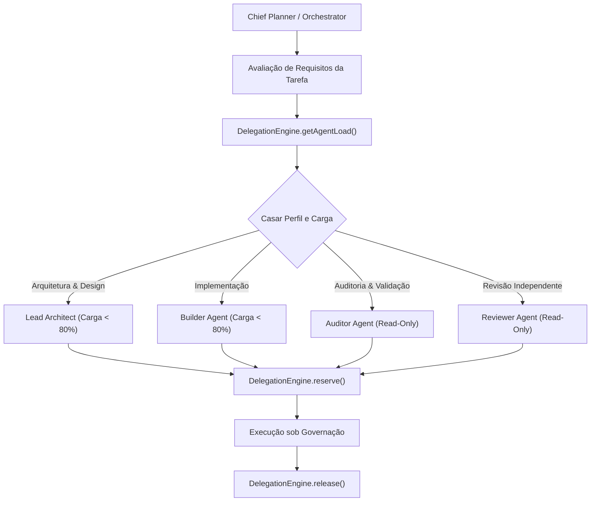

# Behavior-OS — Architecture Trees & Execution Graphs (Nível 5)

> **Documento:** `ARCHITECTURE_TREES.md`  
> **Pipeline:** Architectural Intelligence & Alignment Engine  
> **Data de Análise:** 2026-11-14  
> **Repositório:** `c:\www\behavior-os`  
> **Grafo de Conhecimento:** `graphify-out/graph.json` (3.869 nós, 7.549 arestas, 53 comunidades semânticas)

---

## 1. Import Graph & Package Dependency Graph

A análise estática das 2.157 arestas de importação (`imports`, `imports_from`, `re_exports`, `dynamic_import`) comprova que o grafo de dependências entre pacotes é estritamente acíclico (DAG puro).

### Análise de Ciclos de Importação
- **Ciclos Fortemente Conectados (SCC > 1) com arestas de importação:** **0 ciclos**.
- A verificação direcionada confirma que as referências circulares aparentes encontradas em análises não-direcionadas eram falsos positivos gerados por arestas bidirecionais de contenção (`contains` e `method`), e não por importações circulares em runtime.

---

## 2. AST (Abstract Syntax Tree) Hierarchy

O grafo de código mapeia 3.869 nós AST gerados a partir do código fonte TypeScript (77.995 linhas de código `.ts` distribuídas por 359 ficheiros).

---

## 3. Call Graph — Caminhos de Execução Críticos

O sistema possui 2.066 arestas de chamada direta (`calls`, `indirect_call`, `method`).

### 3.1 Chokepoint de Governação (Execução em Tempo Real)

---

## 4. Control Flow Graph (CFG) — Avaliação de Regras

---

## 5. State Transition Graph — Máquina de Estados de Missão

O ciclo de vida da missão obedece a regras de transição estritas validadas em `packages/core/src/engine/mission-engine.ts`. Nenhuma transição pode violar as invariantes estabelecidas:

---

## 6. State Transition Graph — Ciclo de Vida do Policy Version Ledger

O ledger de políticas promove lições através de estágios unidirecionais imutáveis (`packages/core/src/engine/learning-engine.ts`):

---

## 7. Data Flow Graph (DFG) — Da Ingestão à Persistência

---

## 8. Event Flow Graph — Barramento de Eventos e Telemetria

O sistema emite eventos tipados rastreáveis através do `MetricsEngine` e `event-monitor`:

---

## 9. Task DAG — Decomposição e Execução em Loop

No `behavioros-orchestrator`, as tarefas são orquestradas como um Directed Acyclic Graph (DAG) gerido por `ControlLoop`:

---

## 10. Agent Delegation Graph — Casamento de Capacidades e Carga

O `DelegationEngine` (`packages/orchestrator/src/delegation.ts`) e o `CognitiveLoadBalancerEngine` equilibram o trabalho entre personas:

---

## 11. Diagnóstico de Integridade dos Grafos

1. **Ciclos Circulares:** ZERO ciclos de dependência circular no grafo de imports direcionado.
2. **Caminhos de Bypass:** O chokepoint de permissão em `plugins/opencode-v2/src/governance.ts` interceta todas as chamadas antes da execução técnica no host.
3. **Invariantes Criptográficas:** Todo o ledger de políticas e assinaturas HMAC são validadas antes de qualquer mutação de estado.
