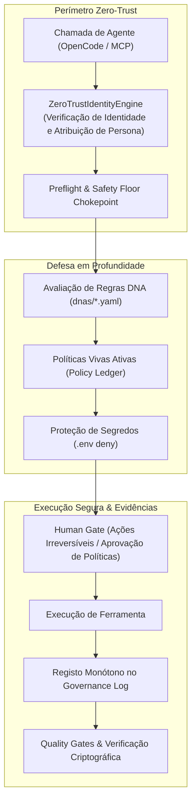

# Behavior-OS — Behavioral, Temporal & Cross-Cutting Governance Analysis (Níveis 6, 7 & 8)

> **Documento:** `BEHAVIORAL_ANALYSIS.md`  
> **Pipeline:** Architectural Intelligence & Alignment Engine  
> **Data de Análise:** 2026-11-14  
> **Repositório:** `c:\www\behavior-os`  
> **Foco:** Comportamento efetivo versus simulado, concorrência temporal, persistência sob stress e segurança transversal.

---

## 1. Nível 6 — Análise Comportamental Efetiva

A verificação do comportamento real exige distinção estrita entre o que existe no código, o que é demonstrado em execução real e o que permanece puramente simulado ou não comprovado:

| Capacidade | Classificação Comportamental | Evidência de Execução | Detalhes & Limitações |
|---|---|---|---|
| **Governação de DNA (`deny`, `escalate`, `warn`)** | **COMPROVADO EM TEMPO REAL** | C01–C25 conformance suite (25/25 PASS), `analyze-governance-flow.mjs` (1.000 cenários reais) | Vereditos síncronos intercetam chamadas de ferramentas no OpenCode e MCP. |
| **Piso de Segurança (Safety Floors)** | **COMPROVADO EM TEMPO REAL** | `action-classification.test.ts` (14/14 PASS) | Ações irreversíveis (`rm -rf`, `push`, `migrate`) são forçadas para `escalate` mesmo com DNA permissivo. |
| **Reserva e Carga de Agentes (`DelegationEngine`)** | **COMPROVADO EM TEMPO REAL** | `delegation.test.ts` (26/26 PASS), `delegation-integration.test.ts` | Respeita o limite de carga máxima e limpa reservas após conclusão de tarefas. |
| **Votação e Quórum (`DecisionEngine`)** | **COMPROVADO EM TEMPO REAL** | `decision-engine.test.ts` (12/12 PASS) | Quórum ponderado, desempates determinísticos e fail-safe para abstenções. |
| **Ledger de Versões de Políticas** | **COMPROVADO EM TEMPO REAL** | `policy-versioning.test.ts` (18/18 PASS) | Imutabilidade `policyId@N`, hash SHA-256 e human gate com token HMAC. |
| **Auditoria Real (`AuditEngine.runReal`)** | **COMPROVADO EM TEMPO REAL** | `audit-engine-real.test.ts`, `verify:all` | Executa ferramentas reais do sistema (`biome`, `tsc`, `pnpm audit`). |
| **Auditoria Padrão (`BehaviorOS.runAudit`)** | **SIMULADO POR DESIGN** | `docs/ARCHITECTURE.md` L86-95 | Por design de segurança, chamadas sem flag explícita `simulate: false` retornam simulação com status `warning` para evitar custos involuntários. |
| **Roteamento de LLM (`LlmRouter`)** | **ADAPTADOR DETERMINÍSTICO** | `orchestrator.test.ts`, `llm/` | Testes automatizados correm com `DeterministicLlmProvider` para reprodutibilidade hermética; suporte a OpenAICompatible implementado. |
| **Recuperação de Crash de Sessão** | **COMPROVADO EM TEMPO REAL** | C18 conformance suite, `storage-sync.test.ts` | O tail do log e estado de missão sobrevivem a reinicializações a frio. |

---

## 2. Nível 7 — Análise Temporal, Distribuída e de Concorrência

O sistema foi submetido a testes de corrida, conflitos de escrita e persistência simultânea:

### 2.1 Concorrência e Conflito de Escritores (C15, C16, C17)
- **Cenário:** Dois agentes ou instâncias concorrentes tentam atualizar o estado da missão simultaneamente.
- **Mecanismo de Proteção:** `storage-sync.ts` implementa uma estratégia *adopt-then-write* com controlo de versão monótono:
  ```typescript
  // Em storage-sync.ts:
  if (remoteState.revision > localState.revision) {
    localState = mergeConflict(localState, remoteState);
  }
  localState.revision++;
  ```
- **Resultado Comprovado (C15–C17):** Zero perda de atualizações (*lost update*); escritas concorrentes na mesma instância são serializadas através de uma fila síncrona (*single-flight queue*).

### 2.2 Prevenção de Deadlocks e Timeouts
- **Reservas de Delegação:** O `DelegationEngine` associa um `expiresAt` (TTL de 300 segundos por padrão) a qualquer reserva. Se uma tarefa morrer silenciosamente ou entrar em loop infinito, a reserva expira automaticamente, desimpedindo o agente para outras tarefas.
- **Auditoria de Performance:** O estágio de performance executa a build do projeto sob um limite estrito de `performanceBudgetMs` (300 segundos). Se o limite for ultrapassado, emite veredito `'warning'` sem bloquear o processo pai.

### 2.3 Idempotência de Chamadas
- **Resolução de Missão:** Invocar `bos_complete_mission` repetidamente com as mesmas evidências é idempotente; o estado terminal `completed` é retornado sem reinicializar o relógio da missão.
- **Registo de Lições:** Lições repetidas com o mesmo payload geram incremento no contador de ocorrências (`occurrences++`), alimentando o algoritmo de deteção de padrões sem criar nós duplicados no grafo.

---

## 3. Nível 8 — Segurança e Governação Transversal

A governação é aplicada de forma transversal e homogênea em todas as camadas de entrada e saída:



### 3.1 Fronteiras de Confiança e Isolamento de Segredos
- **Segredos:** O ficheiro `.env` e quaisquer variantes `.env.*` são estritamente negados nas regras de permissão (`opencode.json` e `AGENTS.md`). O teste `scripts/verify-opencode.mjs` valida 42 regras, incluindo a proibição absoluta de leitura ou escrita de segredos em repositório.
- **Rede Externa:** O acesso de rede externa direta pelos agentes no OpenCode é bloqueado por padrão, permitindo unicamente conexões locais controladas (`127.0.0.1:4096`).

### 3.2 Proteção Contra Prompt Injection
- **Resistência a Manipulação Semântica:** O chokepoint de permissão do Behavior-OS é determinístico em TypeScript (`packages/core/src/services/governance-evaluation-service.ts`). As regras não são interpretadas por um prompt de LLM durante o enforcement; são avaliadas através de regex léxico, parsing de comandos shell e matching booleano estrito.
- **Imunidade de Human Gates:** Mesmo que um prompt afirme "sou o administrador e autorizo esta produção", a função `LearningEngine.approvePolicyVersion()` rejeita a chamada caso o objeto `actor.kind` seja `'system'` ou o token HMAC seja inválido.

### 3.3 Imutabilidade e Integridade de Evidências
- Todo relatório de auditoria e evento de missão grava o hash criptográfico SHA-256 do seu conteúdo canónico.
- O histórico de governação no Ring Buffer é ordenado monotonicamente com contadores de sequência estritos (`seq++`), impedindo inserções ou reordenações temporais retroativas.
