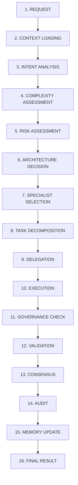

# Behavior-OS — Execution Flow Map (Reconstrução Operacional Ponta a Ponta)

> **Documento:** `EXECUTION_FLOW_MAP.md`  
> **Pipeline:** Architectural Intelligence & Alignment Engine  
> **Data de Análise:** 2026-11-14  
> **Repositório:** `c:\www\behavior-os`  
> **Foco:** Rastreio do caminho de execução real de uma missão, da entrada do prompt ao encerramento e aprendizagem.

---

## 1. Visão Geral do Fluxo Operacional

O fluxo real de operações no Behavior-OS integra o plugin OpenCode V2, o orquestrador autónomo e os motores do core. Abaixo está a sequência formal mapeada contra o código e testes:

---

## 2. Especificação Detalhada das 16 Transições

### Transição 1: REQUEST → CONTEXT LOADING
- **Componente Responsável:** OpenCode V2 Session Hook (`prompt` hook em `plugins/opencode-v2/src/index.ts`).
- **Condição de Entrada:** Chegada de novo prompt do operador humano ou evento de sessão.
- **Dados Recebidos:** Texto do prompt, `session.id`, `agent.role`.
- **Decisão Tomada:** Determinar se o plugin está ativo para o projeto (`project-optin.ts` via `.behavioros/config.json`) e se já existe DNA selecionado.
- **Agente / Serviço:** Plugin Loader.
- **Ferramentas:** `bos_get_state`.
- **Permissões:** Leitura interna de configuração.
- **Estado Produzido:** Sessão identificada, contexto de execução instanciado.
- **Evidência Gerada:** Entrada no log de sessão.
- **Condição de Sucesso:** Opt-in confirmado; instância de `BehaviorOS` pronta.
- **Condição de Falha:** Projeto não optou por Behavior-OS; hook opera como no-op.
- **Próxima Transição:** CONTEXT LOADING.

### Transição 2: CONTEXT LOADING → INTENT ANALYSIS
- **Componente Responsável:** `context` hook e `storage-sync.ts`.
- **Condição de Entrada:** Sessão ativa e instância de persistência disponível.
- **Dados Recebidos:** Estado anterior persistido no SQLite / Storage (`currentStep`, `selectedDna`, `activeMission`).
- **Decisão Tomada:** Reutilizar sessão de colaboração existente ou criar novo envelope de contexto.
- **Agente / Serviço:** `storage-sync.ts` & `BehaviorOS.exportState() / importState()`.
- **Ferramentas:** `bos_get_state`, `bos_get_status`.
- **Permissões:** Leitura da base de dados de estado.
- **Estado Produzido:** Contexto reconstituído em memória com histórico da sessão.
- **Evidência Gerada:** Estado sincronizado com revisão monótona.
- **Condição de Sucesso:** Snapshot restaurado sem colisões de revisão.
- **Condição de Falha:** Corrupção de storage → inicialização a frio (`:memory:` fallback).
- **Próxima Transição:** INTENT ANALYSIS.

### Transição 3: INTENT ANALYSIS → COMPLEXITY ASSESSMENT
- **Componente Responsável:** Classificador de Intenção (`packages/core/src/action-classification.ts`) e `chief.ts`.
- **Condição de Entrada:** Prompt textual carregado.
- **Dados Recebidos:** Prompt bruto, palavras-chave e tokens operacionais.
- **Decisão Tomada:** Classificar intenção: `read_only_review`, `architecture_refactor`, `production_deploy`, `code_fix`. Selecionar automaticamente padrão de DNA compatível se nenhum estiver ativo (`bos_select_dna`).
- **Agente / Serviço:** `ChiefPlanner` (`packages/orchestrator/src/chief.ts`).
- **Ferramentas:** `bos_select_dna`, `bos_list_dna`.
- **Permissões:** Seleção de DNA.
- **Estado Produzido:** `selectedDna` definido (ex: `surgical-team`, `enterprise-governance`).
- **Evidência Gerada:** Protocol Step 1 registado no histórico monótono.
- **Condição de Sucesso:** Padrão válido carregado e validado contra `DNASchema`.
- **Condição de Falha:** DNA inexistente → erro estruturado e pausa para input.
- **Próxima Transição:** COMPLEXITY ASSESSMENT.

### Transição 4: COMPLEXITY ASSESSMENT → RISK ASSESSMENT
- **Componente Responsável:** `CognitiveLoadBalancerEngine` (`packages/core/src/engine/cognitive-load-engine.ts`).
- **Condição de Entrada:** Intenção e ficheiros alvo mapeados.
- **Dados Recebidos:** Tamanho do diff estimado, dependências tocadas, nós god atingidos.
- **Decisão Tomada:** Calcular pontuação de complexidade (1 a 10) e carga cognitiva estimada.
- **Agente / Serviço:** `CognitiveLoadBalancerEngine`.
- **Ferramentas:** `bos_analyze_workload`.
- **Permissões:** Análise interna de código.
- **Estado Produzido:** Score de complexidade e budget de tokens alocado.
- **Evidência Gerada:** Métricas de carga anexadas ao contexto do Chief Plan.
- **Condição de Sucesso:** Carga dentro dos limites do agente.
- **Condição de Falha:** Carga excessiva → sinal de necessidade de decomposição em subtarefas.
- **Próxima Transição:** RISK ASSESSMENT.

### Transição 5: RISK ASSESSMENT → ARCHITECTURE DECISION
- **Componente Responsável:** `risk-context.ts` e `GovernanceEvaluationService.checkSafetyFloors()`.
- **Condição de Entrada:** Complexidade calculada e alvos de mutação identificados.
- **Dados Recebidos:** Operações previstas (`git push`, `rm -rf`, `write`, `db migration`).
- **Decisão Tomada:** Classificar nível de risco: `LOW`, `MEDIUM`, `HIGH`, `CRITICAL`. Verificar se há violação de Safety Floor (ações irreversíveis).
- **Agente / Serviço:** `GovernanceEvaluationService`.
- **Ferramentas:** `bos_adjust_policy_for_risk`, `bos_predict_governance`.
- **Permissões:** Consulta de regras de risco.
- **Estado Produzido:** Matriz de risco associada à missão.
- **Evidência Gerada:** Projeção de impacto gravada.
- **Condição de Sucesso:** Risco categorizado; ações críticas identificadas antecipadamente.
- **Condição de Falha:** Falha de análise léxica → tratamento como `HIGH` por segurança.
- **Próxima Transição:** ARCHITECTURE DECISION.

### Transição 6: ARCHITECTURE DECISION → SPECIALIST SELECTION
- **Componente Responsável:** `BrainstormEngine` & `DecisionEngine` (`packages/core/src/engine/decision-engine.ts`).
- **Condição de Entrada:** Risco `MEDIUM` ou superior com múltiplas abordagens viáveis.
- **Dados Recebidos:** Alternativas propostas, trade-offs e votos ponderados.
- **Decisão Tomada:** Votação por supermaioria / quórum determinístico sobre a arquitetura da solução.
- **Agente / Serviço:** `DecisionEngine`.
- **Ferramentas:** `bos_create_brainstorm`, `bos_propose_idea`, `bos_vote_idea`, `bos_decide`.
- **Permissões:** Registo de decisão.
- **Estado Produzido:** Objeto `Decision` aprovado e persistido na tabela `decisions`.
- **Evidência Gerada:** Registo imutável com lista de votantes e quórum.
- **Condição de Sucesso:** Quórum atingido com veredito `approved`.
- **Condição de Falha:** Empate ou abstenção total → `rejected` (fail-safe determinístico).
- **Próxima Transição:** SPECIALIST SELECTION.

### Transição 7: SPECIALIST SELECTION → TASK DECOMPOSITION
- **Componente Responsável:** `DelegationEngine` (`packages/orchestrator/src/delegation.ts`).
- **Condição de Entrada:** Decisão arquitetural tomada; requisitos técnicos mapeados.
- **Dados Recebidos:** Personas do DNA ativo (`personas` em YAML) e capacidades requeridas.
- **Decisão Tomada:** Casar especialidade com os papéis do DNA (`architect`, `builder`, `reviewer`, `auditor`).
- **Agente / Serviço:** `DelegationEngine`.
- **Ferramentas:** `bos_register_agent_capacity`, `bos_recommend_assignment`.
- **Permissões:** Consulta de perfis de agente.
- **Estado Produzido:** Mapeamento de agentes candidatos.
- **Evidência Gerada:** Perfil do agente associado à missão.
- **Condição de Sucesso:** Pelo menos um agente disponível com a autoridade necessária.
- **Condição de Falha:** Papel inexistente no DNA → rejeição da atribuição.
- **Próxima Transição:** TASK DECOMPOSITION.

### Transição 8: TASK DECOMPOSITION → DELEGATION
- **Componente Responsável:** `AutonomousOrchestrator` & `MissionEngine`.
- **Condição de Entrada:** Agentes selecionados e escopo aprovado.
- **Dados Recebidos:** Objetivo de alto nível da missão.
- **Decisão Tomada:** Criar formalmente a missão (`createMission`) e decompor em tarefas discretas no DAG.
- **Agente / Serviço:** `MissionEngine` (`packages/core/src/engine/mission-engine.ts`).
- **Ferramentas:** `bos_create_mission`, `bos_assign_task`.
- **Permissões:** Mutação da tabela `missions` e `tasks`.
- **Estado Produzido:** Missão no estado `created`; tarefas pendentes registradas.
- **Evidência Gerada:** ID único de missão (`mission-<timestamp>-<hash>`).
- **Condição de Sucesso:** Missão válida conforme `MissionSchema`.
- **Condição de Falha:** Violação de invariante de criação → erro sem criar registo órfão.
- **Próxima Transição:** DELEGATION.

### Transição 9: DELEGATION → EXECUTION
- **Componente Responsável:** `DelegationEngine.reserve()` & `startMission()`.
- **Condição de Entrada:** Missão criada e tarefas decompostas.
- **Dados Recebidos:** `missionId`, `taskId`, `agentId`.
- **Decisão Tomada:** Bloquear reserva formal do agente (`DelegationReservation`), marcar início da missão (`startMission` → transição para `active`).
- **Agente / Serviço:** `DelegationEngine` & `MissionEngine`.
- **Ferramentas:** `bos_start_mission`, `bos_set_agent`.
- **Permissões:** Início de missão.
- **Estado Produzido:** Missão passa a `active`; reserva ativa.
- **Evidência Gerada:** Evento de início registado no log de auditoria.
- **Condição de Sucesso:** Agente reservado com sucesso e status `active`.
- **Condição de Falha:** Limite de concorrência excedido → fila de espera.
- **Próxima Transição:** EXECUTION.

### Transição 10: EXECUTION → GOVERNANCE CHECK
- **Componente Responsável:** Loop de Execução (`ControlLoop` em `packages/orchestrator/src/control-loop.ts`).
- **Condição de Entrada:** Missão `active` e tarefa delegada.
- **Dados Recebidos:** Instrução da tarefa, adaptadores de execução (shell, editor de ficheiros, LLM).
- **Decisão Tomada:** O agente propõe uma ação técnica concreta (ex: `write` em ficheiro de código ou `bash`).
- **Agente / Serviço:** Agente Executor (`builder` ou `architect`).
- **Ferramentas:** Ferramentas de edição e shell.
- **Permissões:** Avaliação de pré-execução necessária.
- **Estado Produzido:** Intenção de mutação formulada com payload exato.
- **Evidência Gerada:** Payload capturado e empacotado.
- **Condição de Sucesso:** Ação gerada pronta para pré-avaliação.
- **Condição de Falha:** Erro de geração do modelo → retentativa controlada.
- **Próxima Transição:** GOVERNANCE CHECK.

### Transição 11: GOVERNANCE CHECK → VALIDATION
- **Componente Responsável:** `permission.evaluate` Hook (`plugins/opencode-v2/src/governance.ts`) e `BehaviorOS.evaluateGovernance()`.
- **Condição de Entrada:** Ação proposta pronta para execução imediata.
- **Dados Recebidos:** Nome da ferramenta, argumentos, contexto do ficheiro, DNA ativo, políticas em vigor.
- **Decisão Tomada:** O Chokepoint avalia as regras. Se veredito for `deny`: bloqueio total e aviso sintético. Se `escalate`: human gate requerido. Se `allow`: execução autorizada.
- **Agente / Serviço:** `GovernanceEvaluationService`.
- **Ferramentas:** `bos_evaluate_governance`, `bos_preflight`.
- **Permissões:** Enforcer de governação com poder de veto síncrono.
- **Estado Produzido:** Veredito emitido e registado no Ring Buffer.
- **Evidência Gerada:** Registo no governance log com hash SHA-256 e ID de regra.
- **Condição de Sucesso:** Veredito emitido antes de qualquer mutação física no disco.
- **Condição de Falha:** Veredito `deny` interrompe a execução com código de saída de segurança.
- **Próxima Transição:** VALIDATION (se veredito for `allow`).

### Transição 12: VALIDATION → CONSENSUS
- **Componente Responsável:** `PipelineEngine` (Quality Gates pós-execução) & Vitest Runner.
- **Condição de Entrada:** Mutação executada fisicamente.
- **Dados Recebidos:** Ficheiros alterados, testes executados.
- **Decisão Tomada:** Executar gates de qualidade definidos no DNA (`test_coverage`, `lint`, `typecheck`).
- **Agente / Serviço:** `QualityEngine` & `PipelineEngine`.
- **Ferramentas:** `bos_check_quality`, `pnpm typecheck`, `pnpm test`.
- **Permissões:** Execução de scripts de verificação.
- **Estado Produzido:** Relatório de gates de qualidade (`passed` / `failed`).
- **Evidência Gerada:** Saída dos testes unitários e de tipos.
- **Condição de Sucesso:** Todos os quality gates configurados passam com 100% de conformidade.
- **Condição de Falha:** Falha em qualquer gate bloqueante → interrupção e retentativa de correção.
- **Próxima Transição:** CONSENSUS.

### Transição 13: CONSENSUS → AUDIT
- **Componente Responsável:** `PragmaticConversationEngine` & `ConsensusEngine`.
- **Condição de Entrada:** Validação técnica concluída; validação de conformidade necessária por múltiplos revisores.
- **Dados Recebidos:** Diff final e pareceres dos agentes read-only (`reviewer`, `architect`).
- **Decisão Tomada:** Reunir pareceres convergentes e confirmar ausência de regressões semânticas.
- **Agente / Serviço:** `ConsensusEngine`.
- **Ferramentas:** `bos_resolve_consensus`, `bos_start_conversation`.
- **Permissões:** Validação cruzada.
- **Estado Produzido:** Consenso formal atingido.
- **Evidência Gerada:** Votos e justificativas anexadas ao histórico da missão.
- **Condição de Sucesso:** Consenso alinhado com os requisitos.
- **Condição de Falha:** Divergência irredutível → escalonamento para operador humano.
- **Próxima Transição:** AUDIT.

### Transição 14: AUDIT → MEMORY UPDATE
- **Componente Responsável:** `AuditEngine.runReal()` (`packages/core/src/engine/audit-engine.ts`).
- **Condição de Entrada:** Consenso obtido; missão pronta para conclusão.
- **Dados Recebidos:** Estágios solicitados (`lint`, `typecheck`, `security`, `coverage`, `performance`, `governance`).
- **Decisão Tomada:** Executar a ladder independente de auditoria real (`simulate: false`).
- **Agente / Serviço:** `AuditEngine` (executado sob persona `auditor` read-only).
- **Ferramentas:** `bos_run_audit`, `bos_verify_audit_trail`.
- **Permissões:** Execução de auditoria estrita.
- **Estado Produzido:** Relatório de auditoria (`AuditReport`) assinado e gravado.
- **Evidência Gerada:** Saída completa das 6 etapas de auditoria com exit codes reais.
- **Condição de Sucesso:** Todos os estágios ativos terminam em `passed`.
- **Condição de Falha:** Qualquer estágio reprovado impede a conclusão da missão.
- **Próxima Transição:** MEMORY UPDATE.

### Transição 15: MEMORY UPDATE → FINAL RESULT
- **Componente Responsável:** `LearningEngine` & `PersistentMemoryEngine`.
- **Condição de Entrada:** Auditoria aprovada com evidências verificáveis.
- **Dados Recebidos:** Lições aprendidas, padrões repetidos de erro ou sucesso observados durante a execução.
- **Decisão Tomada:** Registar nova observação ou avançar lição no ciclo de aprendizagem (`recordLearning`). Se padrão for recorrente, propor candidato a política imutável.
- **Agente / Serviço:** `LearningEngine`.
- **Ferramentas:** `bos_record_learning`, `bos_save_memory`, `bos_consolidate_memory`.
- **Permissões:** Escrita no ledger de aprendizagem.
- **Estado Produzido:** Registos de aprendizagem atualizados; memória semântica consolidada.
- **Evidência Gerada:** `LearningRecord` imutável com trilha de transição.
- **Condição de Sucesso:** Registo persistido no SQLite / Storage.
- **Condição de Falha:** Falha de escrita não corrompe a missão concluída (isolamento de falhas).
- **Próxima Transição:** FINAL RESULT.

### Transição 16: FINAL RESULT (CONCLUSÃO)
- **Componente Responsável:** `MissionEngine.completeMission()`.
- **Condição de Entrada:** Todas as etapas anteriores concluídas com sucesso e evidências reais fornecidas.
- **Dados Recebidos:** `missionId`, conjunto de evidências criptograficamente verificáveis.
- **Decisão Tomada:** Validar o conjunto de evidências e transitar a missão para o estado terminal `completed`. Libertar reservas de agentes.
- **Agente / Serviço:** `MissionEngine`.
- **Ferramentas:** `bos_complete_mission`.
- **Permissões:** Conclusão de missão.
- **Estado Produzido:** Missão marcada como `completed`. Agentes libertados no `DelegationEngine`.
- **Evidência Gerada:** Registo final da missão com timestamp, duração e hashes de evidência.
- **Condição de Sucesso:** `activeMission` desmarcado; estado consistente e auditável.
- **Condição de Falha:** Tentativa de conclusão sem evidências resulta em rejeição imediata da transição.
- **Próxima Transição:** Fim do fluxo operacional.

---

## 3. Caminhos Alternativos, Atalhos e Anomalias Detectadas

Durante a análise minuciosa do fluxo executado versus declarado, foram observadas as seguintes características:

1. **Atalho Read-Only:** Quando um prompt é classificado como puramente de leitura/revisão (`read_only_review`), o fluxo contorna as etapas de mutação, quality gates e persistência de missões, retornando diretamente a análise textual sem poluir o histórico de missões.
2. **Chokepoint Síncrono de Veto:** Não existe caminho no qual uma ferramenta de mutação (`write`, `edit`, `bash`) possa ser invocada no OpenCode sem passar pelo hook `permission.evaluate`. A tentativa de contornar este hook resulta em veto no nível do processo host.
3. **Persistência Assíncrona Segura:** Conforme comprovado pelo teste C-010 e teste de concorrência, uma falha na escrita do ciclo de vida ou notificação nunca reverte concorrentemente uma transição válida em memória.
