# Behavior-OS — System Architecture Map (Nível 0 & Nível 1)

> **Documento:** `SYSTEM_ARCHITECTURE_MAP.md`  
> **Pipeline:** Architectural Intelligence & Alignment Engine  
> **Data de Análise:** 2026-11-14  
> **Repositório:** `c:\www\behavior-os`  
> **Commit de Referência:** `b4124ca` (main, +11 commits sobre `origin/main`)  
> **Modo de Operação:** Strict Read-Only em Produção / Pipeline Isolado em `architectural-pipeline/`

---

## 1. Nível 0 — Visão Sistémica Global

Behavior-OS é uma plataforma e framework de governação comportamental determinística para equipas autónomas de agentes de Inteligência Artificial. A sua responsabilidade fundamental é garantir que agentes operem dentro de limites de segurança, conformidade legal/ética, e critérios rigorosos de qualidade, desacoplando a lógica de governação das instruções nos prompts dos modelos através de padrões declarativos chamados **DNA Patterns** (expressos em YAML em `dnas/`).

```mermaid
graph TB
    subgraph HostEnvironments["Ambientes Host & Consumidores"]
        OpenCode["OpenCode V2 (IDE & Agent CLI)"]
        ExternalMCP["Clientes Externos MCP (Claude Desktop, Cursor, etc.)"]
        CustomApp["Aplicações Custom / SDK Consumers"]
        TerminalCLI["CLI Shell Operator"]
    end

    subgraph IntegrationLayer["Camada de Integração & Ferramentas"]
        Plugin["@behavior-os/opencode-plugin<br/>(102 ferramentas bos_* + 4 hooks)"]
        MCP["@behavior-os/mcp-server<br/>(98 ferramentas bos_* + 2 recursos stdio)"]
        SDK["@behavior-os/sdk<br/>(TypeScript Client API)"]
        CLI["@behavior-os/cli<br/>(Comandos de administração)"]
    end

    subgraph OrchestrationLayer["Camada de Orquestração & Controlo"]
        Orchestrator["behavioros-orchestrator<br/>(AutonomousOrchestrator, Chief Planner, ControlLoop)"]
        Delegation["DelegationEngine<br/>(Agent Reservation & Role Matching)"]
        Adapters["LLM Provider Registry & Adapters<br/>(OpenAICompatible, Deterministic)"]
    end

    subgraph CoreEngineLayer["Núcleo Operacional — @behavior-os/core"]
        Facade["BehaviorOS (Fachada Unificada de Coordenação)"]
        EngineReg["EngineRegistry (48 Motores Especializados)"]
        GovEngine["GovernanceEngine & GovernanceEvaluationService"]
        AuditEng["AuditEngine (6 estágios de auditoria)"]
        LearningEng["LearningEngine & Policy Version Ledger"]
        DecisionEng["DecisionEngine (Votação e Quórum Ponderado)"]
        MemoryEng["PersistentMemoryEngine, KnowledgeGraph & Consolidation"]
    end

    subgraph SchemaLayer["Fundação de Tipos & Contratos — @behavior-os/schemas"]
        Schemas["Zod v4 Domain Schemas<br/>(dna, mission, task, agent, governance, learning, decision, code-edit, etc.)"]
    end

    subgraph PersistenceLayer["Persistência & Estado"]
        SQLite["SQLiteStore (node:sqlite embutido)"]
        Postgres["PostgresStore (pg pool)"]
        MemoryStore[":memory: Store (Hermético para testes)"]
    end

    subgraph DNAStore["Biblioteca de Padrões Comportamentais"]
        DNAs["21 Ficheiros DNA YAML (dnas/*.yaml)<br/>(surgical-team, enterprise-governance, security-hardening, etc.)"]
    end

    OpenCode --> Plugin
    ExternalMCP --> MCP
    CustomApp --> SDK
    TerminalCLI --> CLI

    Plugin --> Orchestrator
    Plugin --> Facade
    MCP --> Facade
    SDK --> Facade
    CLI --> Facade

    Orchestrator --> Facade
    Orchestrator --> Delegation
    Orchestrator --> Adapters

    Facade --> EngineReg
    Facade --> GovEngine
    Facade --> AuditEng
    Facade --> LearningEng
    Facade --> DecisionEng
    Facade --> MemoryEng
    Facade --> DNAs
    Facade --> SQLite
    Facade --> Postgres
    Facade --> MemoryStore

    Facade --> Schemas
    Orchestrator --> Schemas
    Plugin --> Schemas
    MCP --> Schemas
    SDK --> Schemas
    CLI --> Schemas
```

### 1.1 Objetivos e Responsabilidades
1. **Governação Comportamental Determinística:** Intercetar ações propostas por agentes antes da sua execução (`preflight`, `permission.evaluate`) e pós-execução (`quality gates`, `audit`), aplicando regras com níveis (`critical`, `high`, `medium`, `low`) e ações (`block`, `escalate`, `warn`, `log`).
2. **Ciclo de Vida de Missão (7 Passos do Protocolo):** Gerir o fluxo `Select DNA → List DNA → Get State → Create Mission → Start Mission → Run Audit → Record Learning`.
3. **Decisão e Consenso Semântico:** Resolver conflitos, escolhas arquiteturais e aprovação de mudanças através de quórum ponderado determinístico (`DecisionEngine`).
4. **Ciclo de Aprendizagem e Políticas Vivas:** Rastrear lições aprendidas, promover observações para políticas versionadas (`policyId@N`), requerer aprovação humana (`actor.kind === 'human'` ou HMAC-SHA256) e injetar regras ativas no choke point de governação.
5. **Orquestração Multinível de Agentes:** Decompor tarefas complexas, reservar agentes por capacidade cognitiva e carga (`DelegationEngine`, `CognitiveLoadBalancerEngine`) e executar loops fechados de feedback (`AutonomousOrchestrator`, `ControlLoop`).

### 1.2 Entradas e Saídas
- **Entradas:**
  - Comandos e ações de ferramentas (`bash`, `write`, `edit`, `read`, chamadas de ferramentas externas).
  - Prompts e intenções do utilizador (via OpenCode V2 session hooks).
  - Padrões comportamentais YAML (`dnas/*.yaml`).
  - Chamadas de ferramentas MCP/Plugin (`bos_*`).
- **Saídas:**
  - Vereditos de governação (`allow`, `deny`, `escalate`, `warn`).
  - Relatórios de auditoria estruturados (JSON/Markdown dos 6 estágios).
  - Registos de missões, tarefas e evidências criptograficamente verificadas.
  - Notificações de sessão e avisos contextuais para agentes.
  - Artefactos e propostas de código (`CodeFixProposal`, `CodeEditApplyResult`).

### 1.3 Fronteiras Arquiteturais e Isolamento
- **Fronteira 1 — Clientes vs. Servidores de Ferramentas:** Clientes externos comunicam via stdio com `@behavior-os/mcp-server`; o IDE OpenCode carrega `@behavior-os/opencode-plugin` nativamente. O MCP não escuta HTTP.
- **Fronteira 2 — Fachada vs. Motores Internos:** Todos os clientes contactam a classe fachada `BehaviorOS`. Nenhum cliente externo instancia diretamente motores individuais como `GovernanceEngine` ou `LearningEngine`.
- **Fronteira 3 — Orquestrador vs. Governação:** `behavioros-orchestrator` trata da execução técnica e despacho de LLMs; o core `BehaviorOS` trata da autoridade e conformidade. Delegação é dado, não autoridade (ADR-004).
- **Fronteira 4 — Esquemas Tipados:** Todo e qualquer tipo de domínio passa obrigatoriamente por `@behavior-os/schemas` (Zod v4). Não existem tipos definidos ad-hoc nos consumidores.

---

## 2. Nível 1 — Arquitetura Macro (Monorepo e Pacotes)

O repositório é gerido com `pnpm` workspaces e `turbo` (v2.11.7), contendo 8 pacotes de código e 21 padrões de DNA:

| Pacote / Diretório | Versão | Responsabilidade Macro | Ficheiros Chave |
|---|---|---|---|
| `packages/schemas` | 2.3.0 | Camada de contratos Zod para todos os tipos de domínio (Zero dependências internas). | `src/index.ts`, `dna.ts`, `mission.ts`, `governance.ts`, `learning.ts`, `task.ts`, `decision.ts`, `code-edit.ts`, `responsible-ai.ts` |
| `packages/core` | 2.3.0 | 48 motores especializados, fachada `BehaviorOS`, persistência SQLite/Postgres. | `src/engine/behavior-os.ts`, `src/engine/index.ts`, `src/services/governance-evaluation-service.ts`, `src/persistence/` |
| `packages/orchestrator` | 1.0.1 | Orquestração autónoma de tarefas, loop de controlo resiliente, roteamento de LLMs. | `src/orchestrator.ts`, `src/control-loop.ts`, `src/delegation.ts`, `src/chief.ts`, `src/llm/` |
| `packages/mcp-server` | 2.3.0 | Servidor Model Context Protocol via stdio: 98 ferramentas + 2 recursos. | `src/server.ts`, `src/rate-limit.ts` |
| `plugins/opencode-v2` | 2.1.0 | Integração nativa com OpenCode V2: 102 ferramentas `bos_*`, hooks de sessão/permissão, loop-manager. | `src/index.ts`, `src/governance.ts`, `src/event-monitor.ts`, `src/loop-manager.ts`, `src/tools/` |
| `packages/sdk` | 2.3.0 | SDK em TypeScript de alto nível para integração com sistemas legados ou aplicações cliente. | `src/index.ts`, `src/client.ts` |
| `packages/cli` | 2.3.0 | Interface de linha de comando para inicialização, validação de DNA e inspeção. | `src/cli.ts` |
| `examples` | 1.0.0 | Aplicação e fixtures de demonstração para testes de integração de ponta a ponta. | `src/index.ts`, `tests/examples.test.ts` |
| `dnas/` | 2.0.0 | 21 padrões comportamentais declarativos em formato YAML. | `surgical-team.yaml`, `enterprise-governance.yaml`, etc. |

---

## 3. Catálogo dos 48 Motores Especializados (`EngineRegistry`)

Os 48 motores estão instanciados e geridos via `EngineRegistry` (`packages/core/src/engine/index.ts`):

1. `AnomalyDetectionEngine` — Deteção de desvios comportamentais e anomalias estatísticas.
2. `AntipatternEngine` — Varredura e mitigação de antipadrões de código e fluxo.
3. `AuditEngine` — Execução e orquestração dos 6 estágios de auditoria do sistema.
4. `BehavioralUXEngine` — Formatação contextual e feedback de experiência do utilizador.
5. `BrainstormEngine` — Gestão de sessões de geração divergente de ideias e alternativas.
6. `CircuitBreakerIntelligence` — Análise preditiva e recomendações de corte de circuito em falhas contínuas.
7. `CognitiveLoadBalancerEngine` — Ponderação da complexidade das tarefas contra a capacidade do agente.
8. `CollectiveIntelligenceEngine` — Fusão de perspetivas entre múltiplos agentes para decisões difíceis.
9. `ComplianceMapperEngine` — Mapeamento bidirecional entre regras de DNA e normas (SOX, HIPAA, ISO27001).
10. `ConfidenceWeightedGateSelector` — Seleção adaptativa de gates baseada em confiança histórica.
11. `ConsensusEngine` — Resolução de consenso deliberativo e desempate ponderado.
12. `CounterfactualAuditEngine` — Simulação contrafactual "o que teria acontecido se esta regra fosse violada".
13. `CrossDnaLearningEngine` — Propagação de lições aprendidas entre diferentes padrões de DNA.
14. `CrossDnaPipelineTransferEngine` — Migração e transferência de configurações de pipeline entre DNAs.
15. `CrossDomainTransferEngine` — Generalização de aprendizagens de um domínio técnico para outro.
16. `DecisionEngine` — Votação e quórum estruturado (maioria, supermaioria, unânime).
17. `DNALoader` — Leitura, análise léxica e validação de padrões YAML contra o `DNASchema`.
18. `DriftEngine` — Comparação de deriva entre duas versões ou dois padrões de DNA.
19. `DynamicDNAManager` — Ajuste dinâmico em tempo de execução de parâmetros de DNA.
20. `DynamicPolicyEngine` — Síntese dinâmica de regras baseada no contexto operacional atual.
21. `ExperientialLearningEngine` — Aprendizagem baseada na acumulação de experiências passadas.
22. `ExplainableReportEngine` — Geração de relatórios com explicabilidade das decisões de governação.
23. `ExternalSystemAdapter` — Conectores para exportação e integração com SIEM e webhooks externos.
24. `FairnessEngine` — Avaliação algorítmica de viés e justiça em modelos e dados.
25. `GovernanceAsCodeEngine` — Compilação e tradução de políticas de linguagem natural para código executável.
26. `GovernanceEngine` — Avaliação central de regras (`block`, `escalate`, `warn`, `log`).
27. `HybridEvaluationEngine` — Avaliação mista determinística + LLM para casos cinzentos.
28. `KnowledgeGraphEngine` — Grafo de conhecimento semântico triplestore em memória.
29. `LearningEngine` — Ciclo de vida completo de lições, propostas de fix e ledger de versões de políticas.
30. `MemoryConsolidationEngine` — Consolidação periódica de memórias de curto prazo em memórias semânticas permanentes.
31. `MetaCognitionEngine` — Avaliação da confiança interna e rastreio de auto-reflexão dos agentes.
32. `MetricsEngine` — Telemetria operacional, latências, chamadas por ferramenta e contadores de disparo de regras.
33. `MissionEngine` — Máquina de estados formal de missões (`created → active → completed/failed/cancelled`).
34. `NaturalLanguageEngine` — Extração de regras e intenções a partir de linguagem natural.
35. `PersistentMemoryEngine` — Armazenamento persistente de chave-valor e memórias estruturadas.
36. `PipelineEngine` — Execução síncrona do pipeline de gates (pre-gates e post-gates).
37. `PipelinePlannerEngine` — Planeamento de fases e dependências na execução de pipelines.
38. `PipelineRecoveryEngine` — Estratégias de recuperação e retentativa em caso de falhas de pipeline.
39. `PragmaticConversationEngine` — Diálogo estruturado e argumentação entre agentes em desacordo.
40. `PredictionEngine` — Previsão preditiva de violações de governação antes da emissão de comandos.
41. `QualityEngine` — Avaliação de métricas de código (cobertura, complexidade, duplicação).
42. `RecommendationEngine` — Geração de recomendações contextuais baseadas em histórico de missões.
43. `RolePolicyEngine` — Gestão de papéis e políticas de permissões baseadas em RBAC interno de agentes.
44. `TemporalGovernanceEngine` — Políticas dependentes de tempo (horários, prazos, expirações).
45. `TemporalPatternEngine` — Deteção de padrões repetitivos em séries temporais de eventos.
46. `ValueAlignmentEngine` — Alinhamento de objetivos com valores de segurança da organização.
47. `ZeroTrustIdentityEngine` — Atribuição e verificação estrita de identidade de agentes em cada invocação.
48. `CodeEditEngine` — Aplicação cirúrgica de edições de código e mitigação de regressões.

---

## 4. Persistência e Infraestrutura

A persistência do Behavior-OS é agnóstica e configurável através da interface `Store` (`packages/core/src/persistence/store.ts`):
1. **SQLite (`SQLiteStore`):** Utiliza o módulo nativo `node:sqlite` do Node.js (requer Node >= 22.0.0). Cria 9 tabelas relacionais primárias:
   - `missions`
   - `tasks`
   - `agents`
   - `decisions`
   - `events`
   - `audit_reports`
   - `pipeline_runs`
   - `knowledge_nodes`
   - `knowledge_edges`
   - Chave `meta` para o ledger imutável de versões de políticas (`policy-ledger`).
2. **Postgres (`PostgresStore`):** Suporte de nível empresarial via pool de conexões `pg`.
3. **In-Memory (`:memory:`):** Isolamento total utilizado em suites de teste e scripts analíticos para garantir hermetismo.

---

## 5. Garantia de Conformidade e Evidência

A arquitetura macro foi comprovada através das seguintes verificações executadas em tempo real:
- `node scripts/verify-capabilities.mjs` — PASS (98 MCP tools, 2 resources, 102 plugin tools, 4 plugin-only, 48 engines, 21 DNAs, 9 tables).
- `node scripts/verify-tool-parity.mjs` — PASS (98 shared tools com parâmetros idênticos, 4 divergências declaradas restritas a loops).
- `node scripts/verify-plugin.mjs` — PASS (Build limpo de ESM, registo em `.opencode/plugins`, resolução de DNA e chokepoints).
- `pnpm.cmd typecheck` — 11/11 tarefas verdes.
- `pnpm.cmd lint:check` — 518 ficheiros inspecionados sem violações.
- `pnpm.cmd test` — Todos os pacotes com suites verdes.
