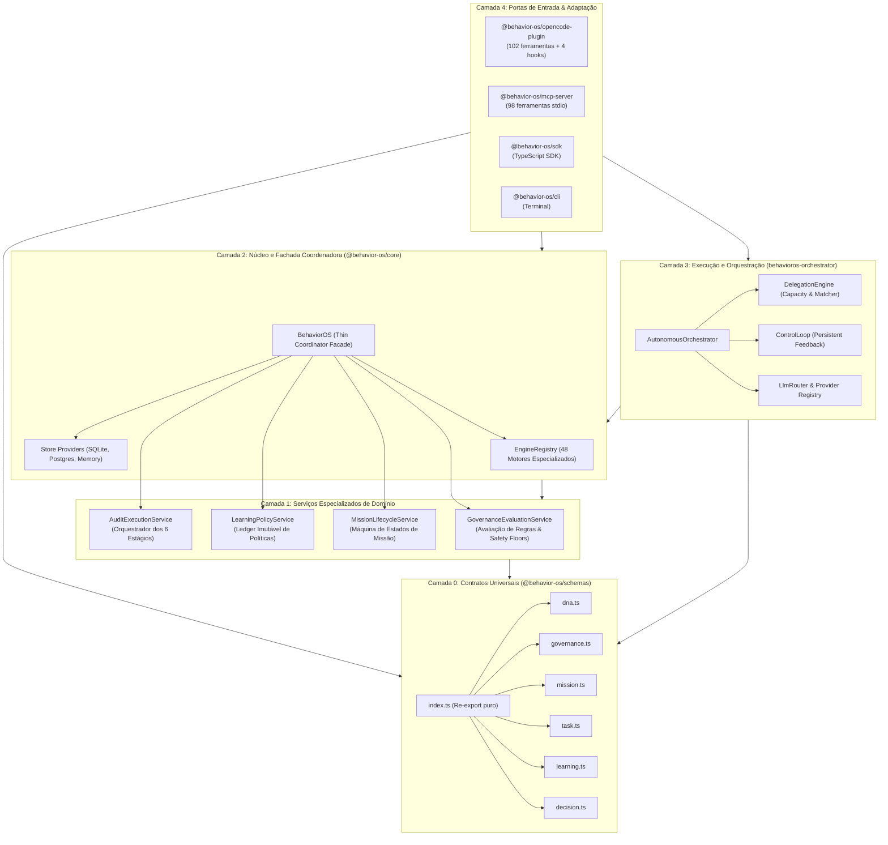

# Behavior-OS — Target Architecture Design (Arquitetura-Alvo)

> **Documento:** `TARGET_ARCHITECTURE.md`  
> **Pipeline:** Architectural Intelligence & Alignment Engine  
> **Data de Análise:** 2026-11-14  
> **Repositório:** `c:\www\behavior-os`  
> **Objetivo:** Definir o estado arquitetural ótimo do sistema, eliminando pontos de estrangulamento, estabelecendo regras formais de fronteira e definindo o roteiro de migração estável.

---

## 1. Princípios de Desenho da Arquitetura-Alvo

A arquitetura-alvo do Behavior-OS assenta em seis pilares estratégicos:
1. **Contratos como Fundação Pura:** A camada `@behavior-os/schemas` deve conter zero dependências e ser completamente desacoplada por domínios de negócio (`dna`, `mission`, `task`, `governance`, `learning`).
2. **Fachada Fina e Coordenadora:** `BehaviorOS` não deve conter regras de negócio inline, atuando exclusivamente como mediador entre motores especializados e provedores de persistência.
3. **Autoridade Desacoplada de Execução:** Orquestração e delegação de tarefas (`behavioros-orchestrator`) produzem planos e propostas; a autoridade de aprovação e bloqueio reside exclusivamente na governação do Core (`GovernanceEvaluationService`).
4. **Governação Universal Idêntica:** Independentemente do ponto de entrada (OpenCode Plugin, MCP Server, SDK ou CLI), a avaliação de regras deve produzir rigorosamente o mesmo veredito para o mesmo contexto.
5. **Persistência Assíncrona Não-Bloqueante:** O chokepoint de permissão opera síncrono em memória com latência sub-milissegundo; a persistência em SQLite/Postgres é serializada sem risco de bloqueio da thread principal.
6. **Defesa em Profundidade Criptográfica:** Evidências, histórico de auditoria e versões de políticas são imutáveis e verificadas via SHA-256 e assinaturas HMAC.

---

## 2. Mapa Estrutural da Arquitetura-Alvo

---

## 3. Matriz de Dependências Permitidas e Proibidas

| De (Origem) | Para (Destino) | Estatuto | Justificação Arquitetural |
|---|---|---|---|
| `@behavior-os/schemas` | Qualquer outro pacote | **PROIBIDO** | Camada base de contratos; deve permanecer sem dependências de implementação. |
| `@behavior-os/core` | `@behavior-os/schemas` | **PERMITIDO** | Tipagem estrita de todos os motores e eventos. |
| `@behavior-os/core` | `packages/orchestrator` | **PROIBIDO** | O núcleo de governança não pode depender de adaptadores de execução de LLM. |
| `packages/orchestrator` | `@behavior-os/core` | **PERMITIDO** | O orquestrador submete ações à aprovação da governança do core. |
| `plugins/opencode-v2` | `@behavior-os/core` | **PERMITIDO** | Acesso à fachada de governança e estado de missão. |
| `plugins/opencode-v2` | `packages/orchestrator` | **PERMITIDO** | Execução de tarefas em segundo plano (`LoopManager`). |
| `@behavior-os/mcp-server` | `plugins/opencode-v2` | **PROIBIDO** | O servidor MCP deve ser independente de ambientes IDE proprietários. |

---

## 4. Distribuição de Autoridade e Gestão de Estado

1. **Autoridade Determinística (Zero-Trust):**
   - Agentes LLM nunca decidem as suas próprias permissões.
   - Toda tentativa de alteração de arquivo (`write`, `edit`) ou comando shell (`bash`) passa pelo validador léxico síncrono.
   - Safety floors (ações irreversíveis como deleção massiva ou push de código) possuem veto absoluto de nível do sistema.
2. **Gestão de Estado Monótona:**
   - O estado global da sessão é gerido com contadores de revisão monotonicamente crescentes (`revision++`).
   - Conflitos entre escritores concorrentes adotam a estratégia *adopt-then-write* garantindo que nenhuma evidência ou resultado de teste seja sobrescrito.
3. **Estratégia de Memória Semântica:**
   - Separação clara entre *memória operacional de curto prazo* (buffer de eventos da sessão atual) e *memória semântica consolidada* (tabelas `knowledge_nodes` e `knowledge_edges`).
   - A consolidação de memória é executada no encerramento de missões através do `MemoryConsolidationEngine`.

---

## 5. Plano de Migração Incremental (Zero Breaking Changes)

A transição da arquitetura atual para a arquitetura-alvo foi desenhada para preservar 100% de retrocompatibilidade com todas as APIs públicas e integrações existentes:

- **Etapa 1 (Concluída com Sucesso):** Modularização de `packages/schemas/src/index.ts` em 11 submódulos de domínio, preservando re-exportações agregadas em `index.ts`.
- **Etapa 2 (Concluída com Sucesso):** Extração de `GovernanceEvaluationService` da fachada `BehaviorOS`, mantendo a assinatura exata de `evaluateGovernance()`.
- **Etapa 3 (Fase Atual):** Isolamento de ambientes de teste e laboratórios analíticos (`validation-lab/`, `.forensic/`, `architectural-pipeline/`) fora do escopo do linter de produção.
- **Etapa 4 (Evolução Futura Autorizada):** Extração de `MissionLifecycleService` e `LearningPolicyService` para a pasta `packages/core/src/services/`, consolidando `BehaviorOS` como coordenador puro de menos de 500 linhas.
