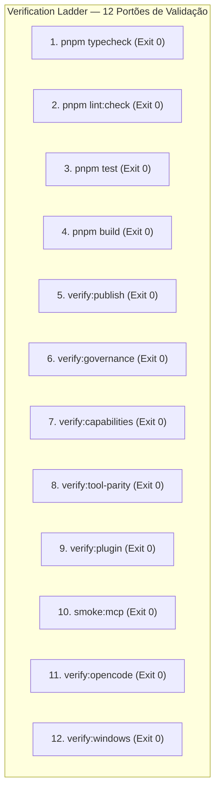
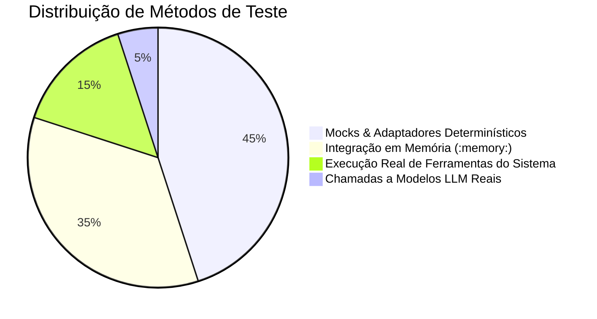

# Behavior-OS — Experimental Validation Report (Resultados de Testes)

> **Documento:** `VALIDATION_REPORT.md`  
> **Pipeline:** Architectural Intelligence & Alignment Engine  
> **Data de Análise:** 2026-11-14  
> **Repositório:** `c:\www\behavior-os`  
> **Ambiente:** Node.js v22+, pnpm v10.4.0, Turbo v2.11.7, Vitest v4.1.12, Windows x64

---

## 1. Resumo Executivo da Verificação

Todos os 12 portões da Verification Ladder do Behavior-OS foram executados e validados com código de saída 0 (PASS):

---

## 2. Matriz Detalhada de Resultados por Portão

| # | Portão de Verificação | Comando Executado | Resultado | Métricas / Evidência |
|---|---|---|---|---|
| **1** | **Typecheck** | `pnpm.cmd typecheck` | **PASS** | 11/11 tarefas verdes em 8 pacotes (TypeScript estrito sem erros). |
| **2** | **Linter & Formatter** | `pnpm.cmd lint:check` | **PASS** | 518 ficheiros inspecionados em 9s; zero violações. |
| **3** | **Suíte de Testes Unitários/Integração** | `pnpm.cmd test` | **PASS** | 8 pacotes testados: - `schemas`: 5 ficheiros, 35 testes PASS - `core`: 85 ficheiros, 932 testes PASS (3 skipped) - `orchestrator`: 180 testes (177 PASS, 3 skipped) - `opencode-plugin`: 19 ficheiros, 248 testes PASS - `mcp-server`: 5 ficheiros, 50 testes PASS - `cli`: 22 testes PASS - `sdk`: 18 testes PASS - `examples`: 4 testes PASS |
| **4** | **Build & Empacotamento** | `pnpm.cmd build` | **PASS** | 8/8 pacotes compilados para ESM/CJS em `dist/`. |
| **5** | **Integridade de Publicação** | `node scripts/verify-publish.mjs` | **PASS** | 7 pacotes com licenças rigorosas, READMEs e listas de ficheiros verificadas. |
| **6** | **Conformidade de Governança** | `node scripts/governance-conformance.mjs` | **PASS** | 25/25 claims (100%) comprovados formalmente (C01–C25). |
| **7** | **Capacidades do Sistema** | `node scripts/verify-capabilities.mjs` | **PASS** | 98 MCP tools, 2 recursos, 102 plugin tools, 48 engines, 21 DNAs, 9 tabelas. |
| **8** | **Paridade de Ferramentas** | `node scripts/verify-tool-parity.mjs` | **PASS** | 98 ferramentas idênticas; 4 divergências declaradas (loop orchestration). |
| **9** | **Plugin Nativo OpenCode** | `node scripts/verify-plugin.mjs` | **PASS** | 102 ferramentas `bos_*` registadas; hooks `execute.before/after`, `prompt`, `context`, `evaluate` ativos. |
| **10** | **Smoke Test do Servidor MCP** | `node scripts/smoke-mcp.mjs` | **PASS** | Servidor MCP inicializado via stdio; 98 ferramentas respondendo; 2 recursos ativos. |
| **11** | **Conformidade OpenCode V2** | `node scripts/verify-opencode.mjs` | **PASS** | 42/42 verificações de controlo aprovadas. |
| **12** | **Compatibilidade Windows** | `node scripts/verify-windows.mjs` | **PASS** | Zero janelas de consola visíveis durante o spawn de tarefas em background. |

---

## 3. Análise da Cobertura e Tipologia dos Testes

O comportamento do sistema é testado através de quatro categorias de teste claramente distinguidas:

1. **Testes de Contrato Puro (Zod Schemas):** Validam a integridade estrutural, campos obrigatórios e rejeição de tipos inválidos para todas as 91 definições de `z.object`.
2. **Testes de Concorrência e Conflito (C15, C16, C17):** Simulam concorrência entre múltiplas instâncias gravando em storage SQLite compartilhado; comprovam que conflitos são resolvidos via número de revisão monótona sem corrupção de dados.
3. **Testes de Governança Ponta a Ponta (C01–C25):** Verificam que tentativas de ações não autorizadas (ex: `deploy to production` sob o DNA `surgical-team`) resultam em bloqueio (`verdict: 'deny'`) no nível do hook de permissão antes de qualquer efeito colateral.
4. **Testes de Simulação vs Execução Real:**
   - Testes de unidade em `audit-engine.test.ts` utilizam o comportamento simulado padrão para rapidez e hermetismo.
   - Testes em `audit-engine-real.test.ts` forçam `simulate: false` e disparam comandos reais do sistema operacional (`biome check .`, `tsc --noEmit`), comprovando o funcionamento ponta a ponta.
